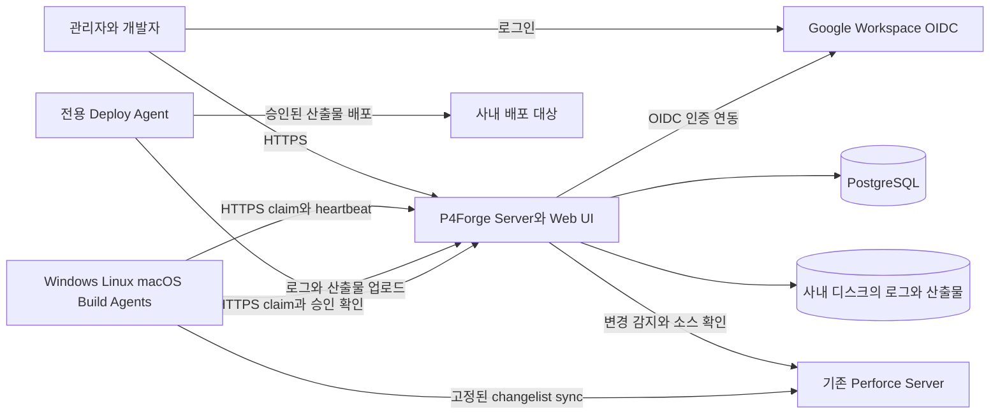

**P4Forge self-hosted CI/CD 구현 계획**

2026-10-08 기준. Perforce 전용 CI/CD를 만들고, 파이프라인 설정은 PostgreSQL에서 관리한다. TeamCity의 작업 의존성, Agent 배정, 빌드 이력, 산출물 전달, 배포 승인 흐름을 제품 범위로 삼는다. 아래는 전체 제품 설계이며 구현 현황은 [README.md](README.md)에 명시한다. 현재 Linux Docker Agent의 수동 실행·Job DAG·공용 workspace·단계 순서·로그·취소·재시작 복구를 구현·검증했다. Windows x64 Agent는 DESKTOP-6N6U52L에 설치·연결됐고, Unicode 소스 동기화와 경로 보정을 넣은 공용 workspace 검증을 통과했다. Agent 자체 경로 수정본의 설치와 취소·재시작 검증이 남아 있다. macOS native Agent는 Mac mini에 설치했고 정상 실행·timeout·취소·강제 종료 후 복구를 검증했다. 파이프라인 간 의존성·artifact·자동 trigger·CD는 후속 단계다.

사용자가 확정한 범위는 **Perforce만 지원**, **VCS 교체 계층 제외**, **ci.toml 설정의 DB 관리**, **self-hosted 운영**, **기존 Google Workspace OIDC 인증 유지**다. 현재 p4forge는 초기 저장소이므로 기존 서비스와의 호환성보다 실행 모델과 데이터 모델을 먼저 확정한다.

초기 운영 가정은 단일 조직의 사내망, Linux 관리 서버 1대, Windows/Linux/macOS Agent 여러 대다. 첫 검증 환경은 Docker의 Perforce 2026.1 무료 범위로 구성하고 운영 시 실제 사내 Perforce에 연결한다. 무료 한도 5 사용자·20 workspace 안에서 client를 정리하고 동시 Job 수를 제한한다. Agent 5~20대와 동시 Job 10개는 후속 부하 시험 목표이며 성능 보장이 아니다. 실제 빌드 도구, 산출물 크기, 배포 대상은 첫 단계에서 실제 프로젝트 1개로 구체화한다. [Perforce 무료 범위](https://www.perforce.com/products/p4/free-version-control)

공개 주소와 Google callback은 `https://p4forge.zenogrid.co.kr:8444/`, `https://p4forge.zenogrid.co.kr:8444/auth/google/callback`이다. 최초 관리자 및 인증서 발급 이메일은 `law80@zenogrid.co.kr`다. SSL은 Traefik/Cloudflare DNS-01으로 구성하며 8444에 연결하는 DNS 레코드는 DNS only를 사용한다. Secret은 `.env`와 별도 ticket 파일에서 관리하며 저장소에 포함하지 않는다.

개발 Perforce의 접속 주소는 `p4forge.zenogrid.co.kr:1666`이다. Docker는 도메인이 가리키는 사내 IP `10.48.100.171`의 TCP 1666에 바인딩한다. Server와 Agent는 이 주소와 읽기 계정 `p4forge`를 사용하며, `//streams/main`의 CL 2 고정 checkout으로 연결을 검증했다.

**lorehub는 실행 구조와 운영 경험을 참고한다.** 참조 기준은 [lorehub 커밋 99dfcb5](https://github.com/zenogrid-law80/lorehub/tree/99dfcb5c5355febc0a018e006595d5c6653fd343)이다. 해당 버전은 Lore VCS와 revision 안의 `.lore-ci.toml`을 사용하며, Rust coordinator/worker, PostgreSQL, 시각적 설정 편집, 실행 그래프를 갖춘다. [lorehub README](https://github.com/zenogrid-law80/lorehub/blob/99dfcb5c5355febc0a018e006595d5c6653fd343/README.md)

| 영역 | 확인한 lorehub 구조 | P4Forge 설계 |
| --- | --- | --- |
| 실행 설정 | 소스 revision의 TOML을 읽고 실행 그래프 정보를 DB에 기록 | DB의 발행된 설정 버전과 실행 스냅샷을 기준으로 실행 |
| 작업 배정 | Pipeline을 Worker가 claim하고 내부 Job을 병렬 실행 | Server가 DAG를 관리하고 Job을 여러 Agent에 배정 |
| 소스 | Lore CLI와 Lore revision | p4 CLI, Perforce 연결, stream/client view, submitted changelist |
| 인증 | Google Workspace OIDC | 기존 Google Workspace OIDC와 도메인 제한 유지 |
| 운영 기반 | HTTP Agent 통신, heartbeat, lease, 재시도 | 같은 개념을 사용하되 Job attempt와 배포 상태를 명시적으로 관리 |

설정·의존성 검증은 [config.rs](https://github.com/zenogrid-law80/lorehub/blob/99dfcb5c5355febc0a018e006595d5c6653fd343/src/ci/config.rs), claim과 lease는 [db.rs](https://github.com/zenogrid-law80/lorehub/blob/99dfcb5c5355febc0a018e006595d5c6653fd343/src/ci/db.rs), 실행과 프로세스 정리는 [worker.rs](https://github.com/zenogrid-law80/lorehub/blob/99dfcb5c5355febc0a018e006595d5c6653fd343/src/runner/worker.rs)를 참고한다. Google Workspace 로그인·세션·CSRF 처리는 [auth.rs](https://github.com/zenogrid-law80/lorehub/blob/99dfcb5c5355febc0a018e006595d5c6653fd343/src/server/auth.rs)를 기준으로 이식한다. 모듈별 테스트와 결합도를 확인한 뒤 필요한 로직만 이식한다. Lore 저장소 서버, repository link 및 AWS 관련 배포 설정은 가져오지 않는다.

**서비스는 Server, Agent, PostgreSQL, 파일 저장소로 시작한다.** Server는 Rust/Axum/Tokio/SQLx, Agent는 Rust로 구성한다. 이는 lorehub와 운영·코드 지식을 공유하기 위한 선택이다. Web UI는 TypeScript로 구현하고 빌드한 정적 파일을 Server에 포함한다. 초기에는 API·스케줄러·Perforce 변경 감지를 하나의 Server 프로세스 안의 모듈로 운영한다.

Agent는 Server로 연결을 시작한다. DB 접근 권한과 서버 서명용 개인키를 Agent에 배포하지 않는다. Server는 빌드 스크립트를 직접 실행하지 않는다. 초기 큐는 PostgreSQL을 사용하고, Redis·Kafka·Kubernetes는 필수 구성에 넣지 않는다. 파일 저장소는 Server 전용 볼륨으로 시작하고 Agent가 인증된 API로 접근한다.

**TeamCity에서 가져올 핵심은 DAG와 동일한 입력에 대한 실행 이력이다.** TeamCity의 build chain은 DAG와 소스 스냅샷을 연결하고, artifact dependency는 실행 결과 파일을 전달한다. P4Forge도 작업 순서와 산출물 전달을 별개로 정의한다. [TeamCity build chain](https://www.jetbrains.com/help/teamcity/build-chain.html), [artifact dependency](https://www.jetbrains.com/help/teamcity/artifact-dependencies.html)

| 첫 운영 버전에 포함 | 후속 범위 |
| --- | --- |
| Project, Perforce 연결, Pipeline, Job, Step | 프로젝트 계층과 버전 고정 템플릿 |
| 수동 실행, submitted 변경 감지, cron 예약 | Perforce trigger 수신, shelved change 검증 |
| Job DAG, 병렬 실행, Agent pool/요구 조건 | Pipeline 간 build chain과 build matrix |
| 설정 초안·검증·발행·diff·과거 버전 복원 | 고급 시각 편집과 템플릿 변경 영향 분석 |
| 실행 그래프, 취소, 전체 재실행, 로그, 산출물 | 안전한 부분 재실행과 성공 작업 재사용 |
| 환경별 승인·잠금·배포 이력·이전 산출물 재배포 | 추가 배포 방식과 점진적 배포 |
| Google Workspace OIDC·프로젝트 권한·감사 기록·백업 복구, macOS Agent | 다중 Server HA |

VCS 플러그인, Git/Lore 연동, SaaS 조직 과금, 클라우드 Agent 자동 생성은 제품 범위에 넣지 않는다.

**설정의 원본은 DB의 버전 있는 구조화 모델로 둔다.** `ci.toml`은 가져오기·내보내기 및 텍스트 편집 형식이다. Perforce 저장소에 파일이 없어도 파이프라인을 생성·실행할 수 있다. 소스 안에 같은 이름의 파일이 있어도 실행 설정을 덮어쓰지 않는다.

1. UI 또는 TOML 입력을 공통 모델로 변환해 초안에 저장한다. `schema_version`을 필수로 두고 알 수 없는 필드, 잘못된 참조, 순환 의존성, 잘못된 경로와 timeout을 검증한다.
2. 발행 시 `pipeline_revisions.definition_jsonb`에 정규화된 설정을 저장한다. 선택적으로 가져온 TOML 원문도 감사용으로 보관하지만, 실행 기준은 구조화된 설정 하나로 통일한다.
3. 발행 버전은 수정하지 않는다. 현재 버전 포인터만 새 버전으로 옮긴다. 초안 수정과 발행에는 `base_revision` 또는 ETag를 적용해 동시 편집 충돌을 반환한다.
4. 실행 생성 시 발행 버전, 확정한 Perforce 입력, 매개변수, Job DAG, Agent 요구 조건, 산출물 연결, 배포 계획을 스냅샷으로 저장한다. 실제 실행 도구 버전은 각 attempt에서 추가 기록한다.
5. 실행 중 설정이 바뀌어도 기존 실행은 유지한다. 과거 실행의 재실행은 과거 스냅샷을 복사한 새 Run이다. 최신 설정으로 실행하는 동작은 별도로 제공한다.
6. 설정 복원은 과거 내용을 새 버전으로 발행한다. Secret은 참조와 버전 식별자만 저장하며, 폐기된 Secret 버전을 사용하는 재실행은 명시적으로 실패시킨다.

UI와 TOML 편집기는 동일한 검증·저장 API를 사용한다. 내보낸 TOML을 다시 가져오면 의미가 같아야 한다. 원문 주석과 필드 순서의 완전한 보존은 첫 버전 요구에 포함하지 않는다.

**데이터 모델은 정의, 실행, 시도를 구분한다.** Pipeline은 재사용 가능한 정의이고 Run은 한 번의 실행이다. Job은 DAG 노드이며 Step은 한 Job 안에서 순서대로 실행한다. 재시도는 새로운 attempt를 만들어 이력을 보존한다.

| 테이블 묶음 | 핵심 데이터와 제약 |
| --- | --- |
| `projects`, `project_members`, `users` | 프로젝트 범위 역할과 활성 사용자, 고유한 Google `sub` 식별자 |
| `auth_sessions`, `oauth_states` | 서버 세션, 만료, 일회용 로그인 state와 nonce |
| `perforce_connections`, `perforce_roots` | 서버 endpoint, 논리 서버 식별자, credential 참조, stream 또는 classic view |
| `pipelines`, `pipeline_drafts` | 이름, 프로젝트, 현재 발행 버전, 초안의 기준 버전 |
| `pipeline_revisions` | Pipeline별 버전 unique, schema version, JSONB 정의, hash, 발행자와 시각 |
| `triggers`, `trigger_events`, `poll_cursors` | 버전 고정된 trigger 설정, 중복 제거 key, 감지 범위와 진행 상태 |
| `runs` | 설정 버전 FK, 소스·실행 스냅샷, 입력 hash, 상태, 재실행 원본 |
| `job_runs`, `job_dependencies`, `job_attempts` | Job 정의 스냅샷, 의존성, attempt 번호, Agent, lease, fencing token |
| `agents`, `agent_pools`, `agent_credentials` | OS·arch·도구 capability, slot, 허용 프로젝트, 인증·폐기 상태 |
| `log_chunks`, `artifacts` | 파일 위치, 순번, 크기, checksum, 생성 attempt, 보존 상태 |
| `environments`, `deployment_runs`, `approvals`, `environment_locks` | 대상 환경, 산출물 manifest, 승인 정책, 승인자, 배포 잠금 |
| `secrets`, `secret_versions`, `audit_events` | 암호문·key ID, 접근 범위, 변경·사용 감사 기록 |

현재 발행 버전은 같은 Pipeline 소속이어야 한다. Run이 참조한 설정 버전과 산출물은 보존 정책이 허용하기 전에는 삭제할 수 없다. 큰 로그와 바이너리는 DB에 저장하지 않는다. 발행 및 Run 생성은 관련 레코드를 하나의 DB 트랜잭션으로 확정한다.

**Perforce 입력은 실행을 만들 때 고정한다.** 공통 VCS 인터페이스 없이 `perforce` 모듈에 연결 확인, stream 조회, 변경 감지, client 생성, sync, 정리를 구현한다. 첫 버전은 한 Pipeline당 하나의 Perforce root를 사용한다. 여러 연결을 등록할 수 있지만 서로 다른 서버를 하나의 원자적 소스 스냅샷으로 취급하지 않는다.

| 입력 | 실행에 기록할 값 |
| --- | --- |
| 연결 | connection ID, 실제 endpoint, 논리 서버 식별자와 접속 서버 정보 |
| 소스 위치 | stream 경로 또는 허용된 classic depot view |
| 소스 버전 | submitted changelist 번호 |
| checkout 설정 | 당시의 stream/client spec, 생성된 view, 필요한 import pin, charset와 LineEnd |
| 실행 환경 | p4 CLI 버전, OS/arch, compiler/SDK 또는 실행 이미지 식별자 |

stream client는 `StreamAtChange`를 설정해 해당 시점의 view와 파일을 사용한다. classic client는 저장한 view와 `@<changelist>` 기반 sync를 사용한다. stream의 view를 임의로 직접 수정하는 방식은 사용하지 않는다. 실제 서버 버전과 stream import 구성을 첫 통합 시험에서 확인한다. 이동 가능한 label이나 외부 import가 입력에 있으면 실제 파일 revision까지 고정하거나 지원하지 않는 구성으로 거절한다. [p4 client](https://help.perforce.com/helix-core/server-apps/cmdref/current/Content/CmdRef/p4_client.html), [p4 sync](https://help.perforce.com/helix-core/server-apps/cmdref/current/Content/CmdRef/p4_sync.html)

각 Job attempt는 전용 client와 작업 디렉터리를 사용한다. 예시 이름은 `p4forge_<agent>_<job>_<attempt>`다. 다른 실행과 workspace를 공유하지 않으며 정상 종료·취소·Agent 복구 시 소유권이 확인된 client와 디렉터리만 정리한다. 초기에는 깨끗한 checkout을 우선하고, workspace 재사용은 잔여 파일·have list·view 변경 검증을 갖춘 뒤 추가한다.

Perforce 계정은 필요한 depot 읽기와 빌드용 client 관리에 필요한 권한으로 제한한다. ticket은 별도 보호 파일로 관리하고 명령 인자·로그에 출력하지 않는다. Server 신뢰 fingerprint, ticket 만료, 접근 거절, 네트워크 실패를 구분해서 보여준다. 소스 파일이 관리 작업으로 삭제되거나 toolchain이 사라진 경우까지 과거 실행의 재현을 보장하지는 않으므로 소스 보존 정책과 실행 환경 버전을 함께 운영한다.

변경 감지는 `p4 changes -s submitted` 계열 조회와 변경 경로 확인으로 구현한다. 여러 경로의 결과는 애플리케이션에서 병합·정렬·중복 제거한다. [p4 changes](https://help.perforce.com/helix-core/server-apps/cmdref/current/Content/CmdRef/p4_changes.html)

- 기본 polling 간격은 30초로 시작하고 서버 부하에 따라 조정한다. cursor는 해당 배치 이벤트와 Run 생성이 DB에 확정된 뒤 진행시킨다.
- 페이지를 끝까지 처리하고 겹치는 구간을 재조회해 재시작·재전송 시 누락을 줄인다. 조회 오류나 권한 오류일 때는 cursor를 전진시키지 않는다.
- 자동 실행의 중복 제거 key는 `trigger_id + trigger_revision + connection_id + root_id + changelist`로 둔다. 수동 실행에는 별도 요청 key를 사용한다.
- 최초 활성화는 현재 제출 상태를 기준점으로 저장한다. 과거 changelist 전체를 자동 빌드하지 않으며, 현재 상태 빌드는 명시적으로 한 번 실행한다.
- 예약 실행은 cron과 IANA timezone을 저장한다. 중단 중 누락된 예약은 기본적으로 건너뛰고, 복구 직후 과거 예약을 한꺼번에 재생하지 않는다.
- Perforce trigger 수신은 후속 최적화다. trigger 메시지를 신뢰해 바로 실행하지 않고 제출 상태와 접근 권한을 다시 검증한다.

**스케줄러는 Job 단위로 DAG와 Agent 용량을 관리한다.** `workspace = "job"`에서는 `needs`가 실행 순서를 정하고 `stage`는 화면 그룹으로 사용한다. `workspace = "pipeline"`에서는 명시된 `stages` 순서를 dependency edge로 변환하고 하나의 Agent가 한 checkout에서 모든 작업을 순차 실행한다. 두 모드를 명시적으로 구분한다. 준비된 Job은 pool, OS, arch, 도구, 프로젝트 권한과 남은 slot이 맞는 Agent에 배정한다. 이 조건 모델은 TeamCity의 Agent requirement 개념을 참고한다. [Agent requirements](https://www.jetbrains.com/help/teamcity/configuring-agent-requirements.html)

Job 상태는 `blocked → queued → assigned → running → finalizing → succeeded`를 기본으로 하고, `failed`, `canceled`, `skipped`, `lost`를 별도로 기록한다. `finalizing`은 산출물 업로드·checksum 확정 단계다. 의존 Job은 필요한 산출물이 확정된 뒤에만 시작한다. 필수 상위 Job이 실패하면 하위 Job을 `skipped`로 처리하고, 독립 Job은 계속 실행한다. Run 취소는 모든 실행 중 Job과 자식 프로세스의 정리까지 추적한다.

1. DB의 준비된 Job을 `FOR UPDATE SKIP LOCKED`로 claim한다. Job, Agent slot, 프로젝트 동시 실행 제한을 같은 트랜잭션에서 확인·갱신한다. 큐 용도의 해당 잠금 사용은 PostgreSQL 문서에 설명되어 있다. [PostgreSQL SELECT](https://www.postgresql.org/docs/current/sql-select.html)
2. claim 요청 ID, attempt ID, lease 만료와 fencing token을 저장한다. 응답이 유실되어 같은 요청이 재전송되면 기존 할당을 반환한다.
3. Agent heartbeat는 10초, lease는 60초를 초기값으로 한다. Agent는 lease를 갱신하지 못하면 기한 만료 전에 실행 중단을 시도한다. 서버 시각과 Agent의 단조 시계를 기준으로 오차 여유를 둔다.
4. 상태 변경·산출물 확정에는 현재 attempt와 유효한 lease를 요구한다. 오래된 Agent의 늦은 성공 보고가 새 실행을 덮어쓰지 못하게 한다.
5. lease 만료는 실행이 실제로 종료되었다는 증거가 아니다. 해당 attempt를 `lost`로 기록하고 기본적으로 자동 재실행하지 않는다. 멱등성이 확인된 CI Job만 정책에 따라 새 attempt를 허용한다.
6. 취소·timeout은 Unix process group과 Windows Job Object 등 OS별 프로세스 트리 제어로 처리한다. Agent 재시작 시 이전 실행의 프로세스·workspace를 조정한 뒤 새 Job을 받는다.

대기 이유는 `dependency`, `approval`, `no_compatible_agent`, `capacity`, `maintenance`, `environment_lock`처럼 구체적으로 제공한다. 운영자는 Agent drain을 설정해 진행 중인 작업을 마친 뒤 유지보수할 수 있다. 큐는 프로젝트별 동시 실행 제한과 대기 시간 기반 우선순위 보정으로 특정 프로젝트의 독점을 줄인다.

분산 실행에서 외부 시스템까지 포함한 정확히 한 번 실행을 보장한다고 가정하지 않는다. DB의 중복 방지와 fencing은 서버 상태를 보호하고, 배포 같은 외부 효과는 별도의 멱등 처리와 복구 절차로 다룬다.

**CI 산출물이 CD의 입력이 된다.** 빌드 → 테스트 → 패키징 → 개발 환경 배포 → 운영 승인 → 운영 배포를 기본 예제로 제공한다. 배포 단계에서는 검증한 artifact ID와 digest를 사용하고 다시 빌드하지 않는다.

- 산출물에는 `run_id`, `job_attempt_id`, 파일 manifest, SHA-256, 크기를 기록한다. 미완료 업로드는 소비할 수 없고 경로 이탈·압축 해제 경로도 검증한다.
- Job 간 전달은 명시적 artifact dependency로 정의한다. 다른 Agent가 같은 파일 시스템에 접근할 수 있다고 가정하지 않는다.
- 운영 승인은 실행 스냅샷 hash, artifact manifest와 환경에 묶는다. 입력이 바뀌면 승인을 다시 받는다. 승인 대기는 Agent slot을 점유하지 않는다.
- 배포 직전에 현재 사용자·환경 권한과 Secret 접근을 다시 확인한다. 운영 배포 정의 발행과 운영 Secret 사용은 별도 권한으로 제한한다.
- 환경별 배포 잠금을 획득한 하나의 deployment만 실행한다. 연결 단절 시 결과를 `unknown`으로 표시하고 잠금을 유지해 자동 재배포를 막는다. 운영자가 대상 상태를 확인한 후 복구·잠금 해제를 기록한다.
- 배포 대상이 지원하면 deployment ID와 fencing token을 함께 검증한다. 일반 SSH·shell 대상에는 그런 보장이 없으므로 자동 takeover를 허용하지 않는다.
- 첫 CD 경로는 전용 Deploy Agent가 수행하는 사내 서버 배포로 잡는다. 실제 대상 1개를 선정해 파일 배포 또는 서비스/컨테이너 업데이트, health check, 실패 복구를 끝까지 검증한다.
- 롤백은 보존된 이전 artifact를 이용한 새 deployment다. DB schema 변경과 외부 데이터 변경은 자동 역실행하지 않고 해당 서비스의 복구 절차를 연결한다.

**사용자는 설정과 실행을 같은 화면 흐름에서 추적한다.** 초기 화면은 다음 범위로 구성한다.

| 화면 | 사용자 작업 |
| --- | --- |
| 프로젝트 목록·상세 | Perforce 연결·stream, 최근 실행, 실패와 대기 현황 확인 |
| Pipeline 편집 | 폼/TOML 편집, Job·Step·needs 설정, 검증, diff, 발행 |
| 실행 시작 | changelist 선택, 발행 버전과 매개변수 확인, 실행 |
| 실행 상세 | DAG, Job/Step 로그, 대기 이유, 산출물, 취소·재실행 |
| Agent 관리 | 승인·폐기, pool, capability, slot, online/offline, drain |
| 배포 환경 | 승인 요청, artifact/changelist/설정 버전, 배포·복구 이력 |
| 운영 설정 | 사용자·역할·Secret·감사 기록·보존 정책·백업 상태 |

설정 API의 중심은 `draft → validate → publish`이고, 실행 API는 `runs → cancel/rerun`이다. Agent API는 `enroll`, `claim`, `heartbeat`, `logs`, `artifacts`, `complete`로 분리한다. Agent에는 현재 할당된 Job 범위만 허용한다. 로그 스트림은 순번 cursor로 재연결하고, 파일 chunk로 저장해 DB와 브라우저 메모리 사용을 제한한다.

**self-hosted 설치와 복구도 첫 운영 버전의 범위다.** 서버는 Docker Compose로 reverse proxy, P4Forge Server, PostgreSQL을 설치하고 로그·산출물·DB·설정·암호화 키를 영속화한다. Windows preview Agent는 SYSTEM 시작 예약 작업과 별도 표준 build 계정으로 배포하며, Windows Service 전환은 후속 운영 선택지다. Linux preview는 Docker, macOS preview는 launchd 설치기를 사용한다. 개발용 단일 장비 설치는 가능하지만 운영 시 빌드 Agent와 관리 서버는 분리한다.

| 항목 | 초기 운영 기준 |
| --- | --- |
| 인증 | 기존 Google Workspace OIDC, `zenogrid.co.kr` 도메인 제한, 서버 세션과 CSRF 보호 |
| 권한 | 프로젝트별 Viewer/Operator/Editor/Admin, 환경별 Approver/Deployer |
| Agent 인증 | 일회용 등록 token과 관리자 승인, Agent별 자격 증명 교체·폐기 |
| Secret | DB 암호문, 외부 파일의 master key, 사용 시에만 Job에 최소 주입 |
| 실행 격리 | 신뢰된 사내 코드용 전용 OS 계정·VM, 빌드와 배포 pool 분리 |
| TLS | Traefik과 Cloudflare DNS-01 CNAME 위임으로 인증서 자동 발급·갱신, 내부망에서도 HTTPS 운영 |
| 저장소 | 로컬 서버 볼륨 기본, 용량·보존 정책과 산출물 참조 추적 |
| 보존 | 예시로 로그 30일·일반 artifact 90일, 현재 운영·승인 대기·복구용 artifact는 보호 |
| 백업 | PostgreSQL, artifact/log 파일, 서버 설정, 암호화 키의 일관된 복구 지점 |
| 관측 | 큐 대기, 실행 시간, offline Agent, lease 만료, Perforce 조회 실패, 디스크 사용량 |
| 업그레이드 | 버전 고정 이미지·바이너리, schema migration, Agent protocol 호환성 검사 |

Google Workspace 로그인은 lorehub와 동일하게 ID token의 서명, issuer, audience, 만료, nonce, `hd`, `email_verified`를 검증한다. 이메일 문자열 대신 Google `sub`를 사용자 식별자로 사용한다. 로그인 화면의 도메인 힌트만으로 접근을 허용하지 않는다. 최초 관리자는 설치 시 지정한 Workspace 계정이 OIDC 검증을 통과한 뒤 부여하고, 프로젝트·배포 권한은 P4Forge DB에서 관리한다. OAuth client ID·secret과 P4Forge callback URL을 배포 설정에 포함한다. [lorehub 인증 동작](https://github.com/zenogrid-law80/lorehub/blob/99dfcb5c5355febc0a018e006595d5c6653fd343/README.md#authentication-and-access-control)

일반 shell 실행은 강한 sandbox가 아니다. 파이프라인을 편집할 권한은 해당 Agent에서 코드를 실행할 권한으로 취급한다. 운영 Secret과 배포 네트워크는 별도 pool과 권한으로 제한한다. Agent의 관리 자격 증명은 Job 환경에서 제거하고, 로그 마스킹은 비밀 유출을 완전히 막는 경계로 간주하지 않는다.

self-hosted 범위는 CI/CD Server·Agent·DB·큐·로그·산출물 저장소이며, 사용자 인증은 기존 Google Workspace에 의존한다. 로그인 브라우저와 Server에서 Google OIDC에 필요한 외부 통신을 허용해야 하므로 완전한 인터넷 차단 환경은 지원 대상에 포함하지 않는다. Google 인증 장애 시 신규 로그인은 실패하며 로컬 로그인으로 우회하지 않는다. 이미 유효한 P4Forge 세션과 독립된 Agent 인증으로 수행 중인 작업은 각 만료·권한 정책에 따라 처리한다. 이미지·Agent 바이너리·p4 CLI·빌드 도구의 사내 배포와 프로젝트 패키지 mirror/cache를 제공해 빌드 실행망의 외부 의존성은 줄인다.

초기 관리 서버 자원은 4 vCPU/8 GB RAM에서 측정을 시작한다. 빌드 CPU/RAM은 Agent가 담당하지만 서버 디스크·네트워크는 로그와 artifact 크기에 맞춰 별도 산정한다. 첫 백업 목표는 RPO 24시간/RTO 4시간으로 제안하며 복구 훈련으로 검증한다. 더 짧은 목표가 필요하면 WAL 보관과 파일 백업 주기를 조정한다. 단일 관리 서버 구성은 고가용성 구성이 아니다.

**구현은 하나의 실제 Perforce 프로젝트를 끝까지 실행하는 순서로 진행한다.** 아래 기간은 Rust 경험이 있는 개발자 2명과 사용할 수 있는 테스트 Perforce 환경을 가정한 초안이다. 순차 합계 약 10~14주이며, 0단계 검증 후 조정한다.

| 단계 | 예상 기간 | 구현 범위 | 완료 기준 |
| --- | --- | --- | --- |
| 0. Perforce 검증과 계약 | 1주 | 실제 빌드 대상·서버 버전 확인, stream/classic sync 실험, 설정 schema와 상태 모델 | 고정 changelist로 깨끗한 workspace를 만들고 변경된 stream 설정의 영향까지 검증 |
| 1. 설정과 서버 기반 | 2주 | Rust 프로젝트, DB migration, Google Workspace OIDC/RBAC, 연결 관리, 초안·검증·발행 API와 UI | Workspace 로그인·도메인 제한 검증, TOML 없이 UI에서 설정 발행, 동시 편집 충돌 처리, 과거 버전 조회·복원 |
| 2. 단일 Job 실행 | 2~3주 | Agent 등록, claim/heartbeat, p4 sync, shell/PowerShell, 로그, timeout·취소 | Windows/Linux/macOS에서 수동 Run 성공, 재시작·응답 유실·프로세스 정리 시험 통과 |
| 3. 파이프라인 CI | 2~3주 | Server DAG, Agent pool/slot, polling·예약, artifact 전달, 실행 그래프 | 같은 changelist의 Job을 두 Agent에서 병렬 실행하고 downstream에 같은 artifact 전달 |
| 4. 배포 | 2~3주 | 환경·승인·권한·잠금, Deploy Agent, health check, 이전 artifact 재배포 | 실제 사내 대상에 승인 배포·실패 복구, 중복 요청·결과 불명 상태 시험 통과 |
| 5. 운영 출시 | 1~2주 | Compose/서비스 설치, 보존·관측, 백업 복구, 업그레이드, 부하 시험 | 새 장비 설치와 장애 후 복구, 운영 문서대로 업그레이드, pilot 프로젝트 지속 운영 |

1차 데모는 2단계 완료, CI pilot은 3단계 완료, CI/CD 첫 운영 버전은 5단계 완료로 구분한다. 고급 시각 편집·템플릿·shelved build·다중 Server·workspace 캐시는 첫 운영 버전 이후에 진행한다.

예상 코드 구조는 `crates/domain`(설정·DAG·상태), `crates/server`(API·DB·스케줄러·변경 감지), `crates/agent`(claim·실행·정리), `crates/perforce`(p4 명령과 출력 해석), `crates/protocol`(Server/Agent 계약), `web`, `migrations`, `deploy`, `tests`다. `vcs-provider` 같은 교체용 계층은 만들지 않는다.

**출시 판정은 정상 빌드와 장애 복구를 함께 검증한다.** 실제 구현 단계에서 아래 시나리오를 자동화하거나 운영 리허설로 확인한다.

| 검증 시나리오 | 통과 조건 |
| --- | --- |
| DB 설정만으로 실행 | depot에 ci.toml이 없어도 실행 가능 |
| 실행 중 설정 발행 | 기존 Run의 명령·DAG·소스가 바뀌지 않음 |
| 발행 경쟁과 잘못된 DAG | 충돌 감지, 순환·미존재 의존성 발행 차단 |
| Perforce 새 제출과 stream 변경 | 실행 생성 시 고정한 changelist와 checkout 입력 유지 |
| Agent 2대의 동시 claim·응답 유실 | 동일 attempt 중복 배정 방지, 재전송 결과 일관성 |
| lease 만료 후 늦은 보고 | 오래된 attempt가 성공 상태와 artifact를 확정할 수 없음 |
| 취소·timeout·Agent 재시작 | 자식 프로세스 추적, 실행 상태 조정, 소유 workspace 정리 |
| 변경 조회 페이지·재시작·권한 실패 | 중복 Run 방지, 실패 시 cursor 보존, 누락 복구 |
| Agent 간 artifact 전달 | 완성된 manifest와 digest가 일치한 파일만 downstream에서 사용 |
| 배포 응답 유실 | 자동 중복 배포 없이 unknown 상태와 환경 잠금 유지 |
| 권한 철회 | 과거 승인·재실행으로 현재 권한을 우회할 수 없음 |
| DB·파일·키 복원 | 설정, 과거 Run, artifact 다운로드와 Secret 사용 복구 |
| Google Workspace 인증 | 허용 도메인만 로그인, 잘못된 token·state·nonce 및 미검증 이메일 거절 |
| 사내망 운영 | Google OIDC 통신을 허용한 상태에서 사내 CI/CD 인프라로 로그인·빌드·승인 배포 가능 |

착수 시에는 실제 Perforce 버전과 stream 구성, 대표 빌드 명령, 배포 대상 1개, 예상 artifact 크기와 Google OAuth client·callback 설정을 확인한다. 이 값들은 실행 환경과 용량을 정하는 입력이며, Perforce 전용·DB 설정·self-hosted·기존 Google Workspace OIDC라는 제품 방향은 확정된 상태로 유지한다.

## root 저장소의 실제 파이프라인 적용

`~/lorehub/root/.lore-ci.toml` 기준 7개 파이프라인·12개 작업을 Perforce 설정으로 변환한다. 실행 명령에 Lore 자격 증명과 commit/push를 남기지 않는다. 생성물은 전용 numbered changelist의 reconcile/submit으로 게시하며 빌드 이미지 태그는 고정 P4 changelist를 사용한다. 원본의 ECR 대상은 유지하고 CI 인프라는 self-hosted로 운영한다.

구성은 현재 DB 초안으로 저장·편집·소스 연결·내보낼 수 있다. 실제 소스는 //streams/root CL 6 (688 files)에 이관하고 재checkout SHA-256을 검증했다. 공용 workspace·stage barrier와 Mac mini Agent를 구현·검증했고 Windows 패키지는 준비했다. Native 실행 설정에는 제한된 Supervisor 게시 계정, 제출 결과 확인, 고정 버전의 후속 실행과 제출 CL 전달을 구현했다. 원본 7개 구성을 실행하려면 ClientBuildView/ServerBuildView 매핑, DESKTOP-6N6U52L 호스트 검증, 원본 needs를 후속 실행 연결로 변환하는 기능과 실행 버전 변환이 남아 있다. 이 계약을 충족하기 전에는 기존의 Job별 독립 workspace 실행기로 변환하거나 발행하지 않는다. 변경 경로 polling과 ECR 배포 자격 증명 연결도 실행 준비 조건이다.

## 2026-10-08 서버 CI 진행 상태

Mac·Windows Agent의 0.1.1 셀프 패치와 Perforce View 실행 검증을 완료했다. 서버 CI는 `server-windows-ci`로 실행 정의를 별도 발행하며 원본 7개 프로젝트 구성 초안의 자동 변환과 게시 기능은 유지보수 후속 범위로 남긴다. `ServerBuildView`는 Server 경로와 생성된 Rust/SQLite 파일을 보존하는 좁은 View다. 같은 Perforce 연결에 속한 서로 다른 View의 후속 실행을 지원하므로 데이터 생성·제출 뒤 고정 CL과 Windows 빌드 버전을 연결할 수 있다.

Windows 빌드는 전용 계정과 작업별 Rust 도구, 기존 MSVC로 단위 테스트·Release 컴파일·실행 파일 검증을 수행한다. 실제 게임 서버 소스/통합 테스트 연결, toolchain 캐시, artifact 전달·자동 보존 정책, 자동 변경 감지, ticket 갱신과 백업 복구는 다음 운영 작업이다.

검증 결과: 데이터 생성 v2가 CL 10을 제출했고, Mac 데이터 확인 v1과 Windows 서버 CI v5가 전달받은 CL 10으로 자동 실행되어 모두 성공했다. Windows 두 crate의 단위 테스트와 두 Release EXE의 실행 검증을 통과했다.

## 2026-10-08 산출물 저장 진행 상태

Agent 0.1.2 / protocol 5와 DB 발행 설정의 `artifacts` 목록으로 서버 영속 디스크 보관·프로젝트 권한 기반 다운로드를 구현했다. 청크 재전송, SHA-256 검증, fence/lease/취소 검사와 성공 완료 조건을 연결했다. `server-windows-ci` v6 / CL 10에서 EXE 두 개와 manifest를 실제 보관했고 다운로드 해시와 서버 재시작 후 보존을 검증했다. `data-table-publish` v3의 후속 버전은 Windows CI v6로 갱신했다.

다음 운영 범위는 저장소 총량 제한, Agent 간 artifact 전달, ticket 만료 감지/갱신, 도구 캐시와 실제 서비스 통합 테스트다. 현재 파일당 64 MiB·실행당 256 MiB·16개 제한이며 프로젝트별 보존 정책으로 자동 정리한다.

## 산출물 보존 정책 적용

root 프로젝트는 사용자 선택에 따라 30일 보관과 파이프라인별 최근 성공 5건 유지 정책을 사용한다. DB 설정·정리 대상 미리보기·관리자 권한·generation 충돌 검사를 구현했다. 실행 중 업로드를 보호하고, 실패·취소된 실행의 파일은 종료 후 24시간이 지나면 정리한다. 삭제 의도를 먼저 DB에 확정해 재시작과 삭제 실패를 복구하며, 파일명·해시·실행 이력·삭제 감사 기록을 보존한다. 자동 정리가 기본 꺼진 다른 프로젝트에는 별도 설정이 필요하다.

남은 저장소 작업은 총량/여유 공간 제한, DB 외부 orphan 파일 진단, 장기 보존용 고정 기능, 대용량 전송과 downstream artifact 전달이다.

## 2026-10-09 Perforce 인증 안정화

서버 전용 비밀 파일로 ticket을 갱신하고 허용된 Mac·Windows Agent에 전달하는 broker를 구현한다. Agent 0.1.3은 Supervisor의 private state 파일을 사용하며 빌드 실행 중에도 갱신·검사를 계속한다. 읽기와 게시 계정을 분리하고, 서버 ID·계정·명시적 Agent 바인딩·실제 인증을 검사한다. 만료 또는 150초 이상 상태 지연 시 새 작업을 차단하고 복구 후 자동 재개한다. Build Agents 화면에 상태와 만료 시각을 표시한다.

이후 우선순위는 Perforce 변경 감지 트리거(경로 필터·중복 방지·cursor 복구), 검증된 artifact의 downstream 전달, 배포 승인·환경 잠금·상태 확인·복구 순서다.

실행 완료: Mac·Windows 0.1.3 셀프 패치, 읽기 2개·게시 1개 ticket 자동 갱신, 서버 재시작 후 정상 복구를 확인했다. 데이터 생성 v3 → CL 11 제출 → Mac 확인 v1·Windows CI v6 체인이 성공하고 산출물 3개 다운로드 해시가 일치했다. Linux 48개 테스트 통과. 현재 원본 Server의 작은 테스트 프로젝트를 대상으로 하며 실제 서비스 배포 검증은 후속 범위다.

## 2026-10-09 제출 감지 자동 빌드

DB 기반 파이프라인별 트리거, 고정 발행 버전, 포함/제외 depot 경로, 관리자 설정 UI를 구현했다. cursor·감지 이벤트·Run·job DAG를 동일 트랜잭션으로 확정해 서버 중단과 동시 scheduler를 복구한다. 최초 활성화는 현재 head부터 시작하고 일반적인 중단/재개는 미처리 CL을 이어서 처리한다. 설정 충돌·현재 관리자 권한·Perforce 인증과 서버 ID를 검사한다. 운영 활성화 범위는 사용자 선택에 따라 `server-windows-ci` v6 / `//streams/root/Server/...`로 한정한다.

다음 우선순위는 검증된 artifact의 downstream 전달, 배포 승인·환경 잠금·상태 확인·복구이며, 자동 감지의 대규모 backlog 처리와 이벤트 보존은 운영 확장 범위다.

운영 적용과 실기 검증 완료: CL 11부터 감지를 활성화한 뒤 CI 운영 문서를 CL 12로 제출했다. Windows 자동 실행 `3e2d957d-8140-4467-bbbc-c7ffc1b6ece1`의 네 단계와 산출물 세 파일 해시 검증이 성공했다. 서버 재시작 후 CL 12 cursor와 실행 1건이 유지됐으며 양쪽 Agent 인증도 정상이다. Linux 자동 테스트 50개 통과, 별도 live 테스트 4개 제외. 증빙은 `.local/trigger-validation/verification.json`에 보관한다.

## 2026-10-09 산출물 후속 전달

성공한 직접 선행 실행의 산출물을 이름·원본 Run·artifact UUID·크기·SHA-256으로 고정해 후속 파이프라인에 전달한다. DB 발행 설정 `artifact_inputs`, 수동 `source_run_id`, 현재 프로젝트 권한, Agent protocol 7, attempt/fence/lease 기반 다운로드와 읽기 전용 입력 디렉터리를 구현했다. 대기 중인 후속 실행과 실행 중 소비자는 자동 정리에서 보호한다. 입력 해시와 바인딩은 변경 불가능하며 최신 빌드로 임의 대체하지 않는다. Agent 0.1.4를 통해 Mac·Windows에 배포한다.

운영 검증은 Windows CI의 EXE·manifest를 Mac에서 검증하고 Windows 후속 실행에서 재검증·실행하는 범위다. 이는 기존 작은 Rust 테스트 프로젝트의 산출물 전달 검증이며 서비스 배포는 별도 단계다. 다음 우선순위는 배포 승인·환경 잠금·상태 확인·복구다.

운영 적용 완료: Mac·Windows Agent 0.1.4 / protocol 7 셀프 패치, `server-windows-ci` v8 → Mac 검증 v1·Windows 검증 v2 자동 체인을 CL 12에서 실행해 모두 성공했다. 입력 세 파일의 SHA-256과 읽기 전용 권한, Windows EXE 실행, 두 OS 검증 보고서 다운로드 해시를 확인했다. 자동 감지는 v8/generation 3/cursor CL 12이며 `data-table-publish` v5도 Windows v8로 연결했다. 서버 재시작 후 바인딩 여섯 개와 후속 실행 두 건이 유지되고 중복 생성되지 않았다. Agent 인증 바인딩 세 개도 정상이다. Linux 자동 테스트 52개와 별도 실제 Linux Agent 테스트 1개, macOS 11개 및 Windows 교차 빌드 검사를 통과했다. 증빙: `.local/input-validation/verification.json`.

## 2026-10-09 배포 승인·환경 잠금·복구

DB 환경과 전용 파이프라인 바인딩, Run별 관리자 승인/거절, 입력 해시·환경 generation 검사, 배정 직전 승인 권한 재확인, 환경 단일 점유와 최종 health Job 계약을 구현했다. 실패·실행 중 취소·Agent 유실 시 잠금을 유지하며 관리자가 외부 작업 종료 근거를 기록한 뒤 해제한다. 현재/직전 성공 배포의 고정 설정·snapshot·산출물로 별도 승인 대기 복구 실행을 만든다. 복구 입력은 보존 정책에서 보호한다.

운영 연결 전 검증 범위는 Windows Agent의 격리 workspace 리허설이다. 실제 서비스 주소, 배포 방식과 상태 확인 URL이 정해지면 해당 환경에 맞는 실행 명령과 대상 시스템 잠금을 연결한다. 지속적인 외부 서비스 모니터링, 2인 승인 정책과 승인 유효기간은 후속 범위다. 환경별 허용 Agent 강제는 아래 후속 구현을 따른다.

운영 적용·리허설 완료: Windows `server-staging-validation` v1 승인 대기(attempt 0건) → 승인 후 성공 → v2 의도적 상태 확인 실패·잠금 유지 → 서버 재시작 후 동일 잠금 확인 → 외부 작업 종료 확인 → 원본 v1 별도 승인 복구가 성공했다. 복구 원본과 실행의 입력 해시 및 산출물 계보가 일치한다. 환경은 generation 11/정상/잠금 해제, 최신 발행 정의는 정상 v3이다. Linux 54개·macOS 55개 자동 테스트가 통과했다. `.local/deployment-validation/verification.json`에 실행·계보·보고서·감사·재시작 검증을 기록했다. 다음 연결에는 실제 배포 대상 서버, 배포 방식, 상태 확인 조건과 접근 정책이 필요하다.

### 실제 서비스 연결 사전 확인

2026-10-09 확인 결과, 원본 `~/lorehub/root`와 Perforce CL 12의 `Server/api_server/src/main.rs`, `Server/config_server/src/main.rs`는 계산 결과를 출력하고 종료하는 테스트 프로그램이다. 상주 서비스나 HTTP 상태 확인 경로가 없으므로 현재 EXE 실행 성공을 실제 서비스의 정상 응답으로 판단할 수 없다. 원본 `.lore-ci.toml`에는 ECR 이미지 발행 명령이 있지만 배포 대상 호스트와 서비스 전환 명령은 없으며, 이 설정에서 self-hosted 서비스 대상을 결정할 수 없다.

사용자가 배포 대상 호스트를 `p4forge.zenogrid.co.kr`로 지정하고 별도 테스트 서비스를 Docker Compose로 배포하도록 선택했다. 이 호스트의 기존 P4Forge는 Docker Compose로 운영하며 웹 TLS 포트 `8444`, Perforce 포트 `1666`을 사용한다. 테스트 서비스는 `https://p4forge.zenogrid.co.kr:8444/deployment-demo/`, 상태 확인은 같은 경로 아래 `/healthz`다.

테스트 서비스의 전용 Compose 프로젝트, 고정 이미지 digest, 릴리스 SHA-256, 파일 잠금, 현재/직전 정상 포인터, HTTPS 전체 응답 검사, 실패 후 재시도/복구 명령을 구현했다. 실제 `demo-v1 → demo-v2 → demo-v1 복구`와 컨테이너 재시작 후 버전 보존을 검증했다. 수동 검증 종료 시점에는 demo-v1이 정상 응답했으며, 이후 상태는 아래 승인 Run 연동 결과를 따른다. 기록은 `.local/deployment-demo/verification.json`, 사용법은 README의 Docker Compose 테스트 서비스 절에 있다.

전용 Compose 실행 경로를 구현했다. `executor.py`는 임의 shell을 실행하지 않고, 승인된 환경의 크기/해시가 고정된 JSON 산출물만 받아 전용 서비스 버전을 전환한다. 변경 전 API에서 현재 승인 권한·환경 소유권·attempt fence/lease를 확인한다. 완료·취소 경쟁, 응답 유실 재전송, 재시작 후 배포 재실행 차단을 다룬다. 기존 빌드 Agent에는 Docker 권한을 추가하지 않았다. 기존 `staging-validation`은 격리 workspace 리허설로 유지한다.

서버 API 반영과 macOS 55개·Linux 54개·Python 8개 자동 테스트를 완료했다. 사용자 명시 승인 후 `root` 프로젝트·`compose-demo` pool 전용 실행기 `6b23c5c8-f30f-4bf6-8d26-d91829b29e3f`를 등록하고 Mac 사용자 LaunchAgent로 자동 시작했다. 기존 빌드 계정의 Docker 권한과 Perforce 권한은 확장하지 않았다.

실제 연동 완료: `compose-demo-release` v2의 ci-v1 산출물 → 승인 배포 `e3ff7d0a-7247-491b-a6d4-4bf888c48aa1`, 생성 v3의 ci-v2 산출물 → 자동 후속 Run·별도 승인 → 배포 `b3aa762d-b424-49fd-ba11-eca28e195a1a`, 원본 ci-v1 복구 요청·별도 승인 → 복구 `8995b2ec-00e1-4825-a34c-4a64070c2b85` 모두 성공했다. 각 승인 전에는 attempt 0건, 완료 후에는 1건이며 복구의 원본 입력 해시·artifact 계보와 실제 HTTPS 응답이 최초 성공과 일치한다. 환경은 generation 10, 정상, 잠금 해제 상태다. 증빙은 `.local/compose-executor-validation/`에 저장한다.

## 2026-10-09 배포 환경별 Agent 제한

환경에 정확한 Agent ID를 지정하고 승인·작업 배정·전용 실행기 사전 확인에서 서버가 강제한다. 동일 pool의 다른 Agent도 해당 배포를 받을 수 없다. 변경은 공용 목록의 활성 Agent를 대상으로 관리자 사유와 generation 검사를 거쳐 기록하며, 환경을 점유한 실행이 있으면 차단한다. 미지정·폐기·pool/플랫폼 불일치 상태의 승인을 거절하고 승인 당시 Agent ID를 별도로 보존한다. 기존 환경에는 Agent를 자동 추정하지 않는다.

DB 백업 후 migration 0015와 서버/UI를 적용했다. `compose-demo`는 기존 전용 실행기, `staging-validation`은 `DESKTOP-6N6U52L`에 지정했다. 새 자격 증명이나 Agent의 추가 권한은 필요하지 않았다. 기존 성공 입력의 재적용 `34bf7192-d122-41d8-b1e7-8efaf30a680d`와 Windows 리허설 `dee39707-fc3c-4a16-9ea8-54940a135250`이 각각 지정 Agent에서 attempt 1건으로 성공했다. 승인 전에는 attempt 0건이며 원본 입력 해시와 실제 HTTPS ci-v1 응답이 유지됐다. 두 환경은 정상·잠금 해제 상태다.

macOS 56개·Linux 55개 자동 테스트, clippy, TypeScript와 format 검사가 통과했다. 동시 승인 테스트는 실제 승자 Run의 해시를 비교하도록, lease 정리 테스트는 거절된 요청의 비동기 rollback 후 잠금 해제를 기다리도록 보완했다. 검증 기록은 `.local/executor-binding-validation/verification.json`이다. 다음 운영 범위는 지속적인 서비스 상태 확인, 승인 유효기간·2인 승인, 백업 복구 훈련이다.

## 2026-10-09 실행 DAG 시각화

실행 상세에 조회용 Job DAG를 구현했다. 실제 의존 관계를 기준으로 선행·후속 작업과 병렬 분기·합류를 배치하고 stage·상태·Agent를 표시한다. 선택한 노드에서 실패 사유·종료 코드·cursor 기반 로그를 조회하며 공용 workspace 로그 범위를 명시한다. 5초 상태 갱신, 자동 갱신 중지, 조회 오류 복구, 화면 이동 시 정리와 키보드·모바일 접근을 지원한다. 파이프라인 간 연결 조회는 아래 후속 구현을 따른다. 그래프 편집기는 다음 단계다.

로컬 검증: 레이아웃 테스트 7개, 샘플 API를 사용한 Chrome 브라우저 검증 9개 항목, 서버 cargo check·clippy와 format 검사를 통과했다. 브라우저에서는 기존 앱의 Viewer 실행 조회, 로그 응답 경합, 자동 갱신·중지, 오류 복구, 모바일 스크롤과 CSP를 확인했다. 검증 기록과 화면은 `.local/graph-validation/`에 있다.

사용자 승인 후 운영 서버 이미지 재빌드·교체를 완료했다. DB migration 15개의 checksum이 기존 DB와 일치함을 확인하고 대기·실행 중 작업이 없는 시점에 서버만 교체했다. `/healthz`·`/readyz`와 앱·그래프·CSS의 HTTPS 제공 및 로컬 해시 일치, 비인증 API 차단, Agent 3대 재연결과 두 배포 환경의 정상 상태를 확인했다. 실제 로그인한 Chrome에서 `server-windows-ci` v8 / CL 12 실행 `e3724063-ccf4-49cc-b17d-ab8b126b0370`의 그래프·노드 상세·로그 추가 조회·상태 갱신을 검증했다. 이전 이미지는 `p4forge-server:pre-graph-20261009-0727`, 운영 검증 기록은 `.local/graph-deployment/verification.json`에 보관한다.

## 2026-10-09 에이전트 탭과 Docker 상태

LoreHub Runner 화면을 참고해 상단 에이전트 메뉴를 별도로 추가했다. `#agents` 및 `#runners` 직접 접근, 공용 에이전트 목록, OS·아키텍처·Docker 엔진·가용성 필터·이름/OS/Pool 검색, 전체·온라인·오프라인·폐기 요약, OS/architecture·버전·마지막 연결과 5초 상태 갱신을 제공한다. 기존 프로젝트 화면의 Agent 등록·배정 중지/재개·자격 증명 폐기·셀프 패치·Perforce 인증 상세를 이 탭으로 옮겼으며 서버 관리자 접근 범위를 유지한다.

migration 0016과 인증된 자기 상태 보고 API를 추가했다. Native Agent 0.1.5는 실제 빌드 계정의 기본 환경에서 대기 중 60초마다 Docker 엔진 접근을 5초 제한으로 확인한다. 빌드 프로세스 정리와 충돌하지 않도록 실행 중 작업과 병행하지 않는다. 전용 Compose 실행기는 기존 실행 계정·환경으로 점검한다. 사용 가능·CLI 없음·엔진 접근 불가·확인 실패·확인 전과 오래된 결과를 구분하며, Docker 권한 및 작업 배정 조건은 변경하지 않는다.

Rust 58개(외부 Perforce 통합 2개 제외), 웹 10개, Python 9개 테스트, clippy, format, Windows 교차 컴파일 검증이 통과했다. 샘플 Chrome UI에서 검색·빈 결과·관리 상세·탭 전환·뒤로가기를 확인했고, 운영 로그인 화면에서 프로젝트 필터와 실제 상태 자동 갱신을 확인했다.

운영 DB 백업 후 서버와 migration 0016을 적용하고 기존 Mac·Windows 에이전트를 공식 셀프 패치로 0.1.5에 업데이트했다. 두 업데이트 모두 succeeded이며 세 에이전트 모두 온라인·배정 가능하다. 실제 Docker 상태는 compose-demo-executor=available/Linux, mac-mini=engine_unavailable, desktop-6n6u52l=cli_missing이다. 두 배포 환경은 healthy·잠금 해제, 테스트 서비스 ci-v1은 정상 응답한다. 복구 이미지는 `p4forge-server:pre-agent-status-20261009-0747`, DB 백업과 검증 기록은 `.local/agent-status-validation/`에 보관한다.

## 공용 에이전트 모델 (2026-10-09, 운영 반영 완료)

에이전트는 프로젝트 소속을 제거하고 OS·아키텍처와 Docker 엔진 종류·가용성을 기준으로 정의한다. 등록 API·CLI·화면에서 프로젝트 선택을 제거했으며, 모든 프로젝트의 일치하는 작업을 처리한다. Pool은 전용 실행기를 구분하는 추가 조건으로 유지한다. `runner.docker = "linux" | "windows"`를 지정한 작업은 protocol 8 이상과 150초 이내의 정상 엔진 점검이 필요하다. 기존 작업과 protocol 7 전용 실행기는 Docker 조건이 없는 경우 계속 호환된다.

Migration 0017은 에이전트 ID·토큰·이력을 유지하고 이전 소속을 감사 기록에 남긴다. 배포 환경은 공용 목록에서 정확한 Agent를 지정하며 프로젝트 관리자 권한·승인·잠금·fence 검사를 유지한다. Perforce는 명시적 Agent UUID·연결·서버 ID 및 유효한 ticket 상태를 검사한다. 2026-10-09 운영 서버에 migration 0017과 메뉴 개편을 배포했고 Mac·Windows Agent 0.1.6 셀프 패치가 성공했다. 기존 자격 증명·48개 attempt를 보존하고 에이전트 3대와 Perforce 인증 정상 상태를 확인했다. 공개 HTTPS의 JS·CSS 해시가 로컬 검증본과 일치한다. 배포 전 DB 백업과 이전 이미지, 검증 결과는 `.local/global-agents-deployment/`에 보관한다.

## 워크스페이스 집계 메뉴 (2026-10-09, 로컬 구현)

다음 메뉴 개선 단계로 개요·전체 실행·관리자용 운영 상태를 구현했다. 개요는 접근 가능한 전체 프로젝트의 실행 현황과 확인할 배포를 집계한다. 전체 실행은 프로젝트·검색·상태 필터와 등록 시각/UUID 커서로 최근 100건 밖의 이력을 탐색한다. 운영 상태는 프로젝트 소속 없이 공용 에이전트·Perforce 인증·자동 빌드 지연·배포 복구 필요 항목을 표시한다. 기존 승인·환경 잠금·에이전트 실행 조건은 유지한다.

서버 통합 테스트 31개 통과(실제 Perforce가 필요한 1개 제외), 웹 테스트 16개와 TypeScript 빌드·clippy·format 검사를 완료했다. 권한별 집계·권한 회수 후 커서 사용·동일 시각 105건·조회 중 새 실행 삽입·인증 검사 지연/만료/오류를 검증했다. 샘플 API를 사용하는 로컬 브라우저에서 검색·페이지 이동·배포 탭 링크·일반 사용자 접근 제한·갱신 실패의 이전 결과 유지·늦은 응답 격리·390px 화면을 확인했다. 증빙은 `.local/workspace-preview/`에 있다. 운영 배포와 migration 0018 적용은 아직 수행하지 않았다.

## 에이전트 활성·폐기 구분과 상세 연결 (2026-10-09, 로컬 구현)

에이전트 기본 목록을 활성 상태로 한정하고 온라인·오프라인·새 작업 중지·폐기 이력·전체 필터를 추가했다. 검색·OS·아키텍처·Docker 조건과 선택한 Agent UUID를 URL에 저장한다. 운영 상태의 문제 항목에서 해당 Agent 관리 상세로 이동하며, 새로고침·뒤로 가기에도 선택을 복원한다. 폐기 후에는 조회 전용 이력으로 이동하고 호스트 서비스 종료는 별도 작업임을 표시한다. 다른 화면에서 등록·폐기·작업 중지 상태가 바뀌면 자동 갱신 시 목록과 관리 버튼을 재구성한다.

웹 테스트 18개, TypeScript 빌드와 Rust 서버의 정적 웹 파일 포함 검사를 통과했다. 샘플 브라우저에서 기본 활성 목록·폐기 상세의 변경 버튼 제거·등록 상태와 Docker 복합 필터·URL 복원·운영 문제 상세 링크·샘플 폐기 후 이동·없는 Agent와 필터 밖의 Agent·외부 등록/폐기의 자동 반영·390px 화면을 검증했다. 증빙은 `.local/agent-lifecycle-preview/`에 있다. 실제 운영 Agent 상태를 바꾸거나 서버를 배포하지 않았다.

## 실행 배정 점검 (2026-10-09, 로컬 구현)

실행 상세에 배정 점검 탭과 그래프의 대기 작업에서 이동하는 링크를 추가했다. 고정된 Run·Job 조건을 기준으로 승인·취소·선행 작업·동시 실행 한도와 후보 에이전트의 플랫폼·Pool·Docker·프로토콜·관리형 Perforce 인증 상태를 구분한다. 배포 환경의 정확한 허용 Agent를 적용하며 프로젝트 열람자는 요약, 서버 관리자는 후보 상세를 확인한다. 조회 API는 읽기 전용이며 실제 작업 배정 조건은 유지한다. migration 0019는 기존 인증된 claim의 지원 프로토콜 관측 필드를 추가한다. 기존 Agent 업데이트는 필요하지 않다.

서버 통합 테스트 33개 통과(실제 Perforce가 필요한 1개 제외), 웹 테스트 18개·TypeScript 빌드·workspace clippy·format 검사를 완료했다. 권한 회수·전역 후보 상세 비공개·고정 실행 조건·Docker 프로토콜과 실제 claim·인증 상태·배포 승인/권한/복구·점유/동시 실행 한도를 검증했다. 샘플 API 브라우저에서 그래프·후보 상세·배포 승인 링크, URL 복원, 열람자 화면, 조회 실패 시 마지막 결과 유지, 실행 종료 시 상단 상태/취소 버튼과 자동 갱신 중지, 390px 화면을 확인했다. 증빙은 `.local/dispatch-preview/`에 있다. 운영 서버와 실제 에이전트는 변경하지 않았으며 migration 0018·0019는 운영에 미적용 상태다.

## 워크스페이스 메뉴·배정 점검 운영 배포 (2026-10-09)

사용자 진행 승인 후 개요·전체 실행·운영 상태·에이전트 활성/폐기 필터와 배정 점검을 함께 배포했다. 대기·실행 중 작업이 없는 시점에 접근 제한된 DB 백업과 이전 이미지(`p4forge-server:pre-dispatch-20261009-092513`)를 보관하고 서버만 교체했다. migration 0018·0019가 적용됐으며 전체 19개 migration checksum이 소스와 일치한다.

공개 HTTPS의 건강 상태·JS/CSS 일치·비인증 API 차단과 실제 로그인 화면의 다섯 메뉴를 검증했다. `compose-demo-executor`는 protocol 7로 온라인, Windows Agent는 protocol 8로 온라인이며 `mac-mini`의 폐기 상태를 유지했다. ID·토큰·인증 바인딩, attempt 48건과 산출물 23개, 두 배포 환경의 generation·성공 Run·정상 상태를 보존했다. Windows Perforce 읽기 인증과 자동 빌드 v8/cursor CL 12가 정상이고 테스트 서비스는 기존 ci-v1 릴리스 해시를 유지한다. 운영 검증·백업·화면은 `.local/dispatch-deployment/`에 있다.

## 파이프라인 연결 관계 (2026-10-09, 로컬 구현)

파이프라인 상세에 연결 관계 탭을 추가하고 목록·발행 이력에서 연결했다. 선택한 발행 버전의 고정 `on_success` 참조를 따라 파이프라인·버전 단위로 표시한다. 산출물 전달 이름과 게시 결과 CL/입력 CL 조건, 배포 승인 여부, 해당 버전의 개별 최근 실행 및 승인·복구 화면 이동을 제공한다. 현재 버전이 변경돼도 이전 버전의 그래프와 실행 이력을 유지한다. 조회 API는 프로젝트 열람 권한과 최대 65개 버전을 적용하며 스크립트·자격 증명·출력 경로를 노출하지 않는다.

서버 통합 테스트 34개 통과(실제 Perforce가 필요한 1개 제외), 웹 테스트 22개·TypeScript 빌드·workspace clippy·format 검사를 완료했다. 고정 이전 버전, 같은 파이프라인의 여러 버전, 산출물·CL 전달, 버전별 실행 이력, 권한 회수·다른 프로젝트·비로그인 차단을 검증했다. 샘플 브라우저 검증은 `.local/pipeline-connections-preview/verification.json`에 기록한다. 운영 미배포 상태이며 추가 migration이나 Agent 업데이트는 없다. 실제 Run 체인 추적은 아래 후속 구현을 따른다. 그래프 편집은 후속 범위다.

## 실행 체인 추적 (2026-10-09, 로컬 구현)

실행 상세에 실행 체인 탭을 추가했다. 실제 `run_followups` 실행 ID로 자동 선행·후속 및 분기를 조회하고, 고정 Run 정의에 있는 아직 생성되지 않은 후속은 선행 성공 대기·등록 대기·등록 차단·실행 안 함으로 구분한다. 실행별 버전·입력 CL·Perforce 제출 결과·배포 승인 상태와 차단 사유를 제공한다. 기존 실행 정보에서 체인으로, 산출물에서 제공 Run으로 이동할 수 있다. 현재 발행 버전이나 같은 CL의 별도 Run으로 관계를 추정하지 않는다.

조회 API는 요청마다 프로젝트 열람 권한을 확인하고 같은 프로젝트 내 최대 65개 노드에 한정한다. 일관된 읽기 트랜잭션을 사용하며 순환·버전 불일치·다른 프로젝트 연결을 거절한다. 5초 자동 갱신·중지·종료 감지와 선택/초점/스크롤 유지, 이전 결과를 보존하는 오류 표시와 화면 이동 시 응답 무시를 지원한다.

서버 통합 테스트 36개(실제 Perforce fixture 1개 제외), 웹 테스트 25개·TypeScript 빌드·workspace clippy·format 검사를 통과했다. 실제 관계/동일 CL 별도 실행/이후 발행 분리, 후속 생성 전후·실패/취소·순환, 승인 상태, 프로젝트 접근·권한 회수·읽기 전용 동작을 검증했다. 샘플 브라우저 증빙은 `.local/run-chain-preview/verification.json`에 보관한다. 이번 변경과 앞선 파이프라인 연결 관계의 운영 적용은 아래 배포 기록을 따른다. 추가 migration·Agent 업데이트는 없다. 그래프 편집과 수동·복구 실행 간 관계 시각화는 후속 범위다.

## 연결 관계·실행 체인 운영 배포 (2026-10-09)

사용자 배포 요청에 따라 파이프라인 연결 관계와 실행 체인을 함께 운영 반영했다. 검증한 소스 해시를 확인하고 대기·실행 중 작업이 없는 시점에 0600 DB 백업과 이전 이미지(`p4forge-server:pre-chain-20261009-103737`)를 보관한 후 서버만 교체했다. 추가 migration·Agent 업데이트는 수행하지 않았다.

새 서버가 healthy·ready이며 공개 HTTPS의 JS/CSS는 로컬 검증본과 일치한다. 새 API의 비로그인 접근을 차단하고 실제 로그인 화면에서 Windows CI v8의 고정 Mac v1·Windows v2 연결과 산출물, 후속 Windows Run에서 선행·다른 분기를 포함한 실제 실행 3개의 체인을 확인했다. 기존 migration 19개 checksum, Agent ID·자격 증명·등록 상태, attempt 48건·산출물 23개와 두 배포 환경의 정상·잠금 해제 상태를 보존했다. 활성 Agent 두 대는 온라인이고 mac-mini는 폐기 상태다. 재시작 뒤 Windows 인증 점검이 ready로 복귀했으며 자동 빌드 v8/cursor CL 12와 테스트 서비스 ci-v1도 정상이다. 백업·검증·화면은 `.local/chain-deployment/`에 있다.

## 다음 메뉴 개선 계획 (2026-10-09, 계획 수립)

개요·전체 실행·운영 상태, 공용 에이전트, 실행 배정 점검, 발행 버전 연결 관계와 실제 실행 체인은 운영 반영된 기준으로 삼는다. 아래 항목은 순차 개선 계획이다. 1단계 진행 결과는 아래 실행 진단 요약 기록을 따른다. 기존 화면 간 이동과 원인 확인을 먼저 개선한 뒤 설정 편집과 저장소 관리로 확장한다.

1. **실행 진단 요약 — 운영 반영 완료**
   - 개요의 확인 영역에서 현재 후속 등록 차단·배포 승인 대기·복구 확인 필요를 모으고, 최근 24시간 실패 이력은 별도로 표시한다. 과거 실패를 현재 장애로 단정하지 않는다.
   - 원인이 기록된 Run·Job·후속 연결을 기준으로 상태, 발생/확인 시각, 파이프라인·버전·CL, 원인과 상세 이동 링크를 제공한다. 실패는 해당 작업과 로그, 후속 차단은 부모 Run의 실행 체인, 승인·복구는 배포 상세로 연결한다.
   - 배정 대기는 오래된 순으로 살펴볼 수 있게 하고 기존 배정 점검으로 연결한다. 폐기된 Agent나 OS·아키텍처·Docker 조건을 만족하는 후보 부족 등 현재 후보 상태를 과거 실패의 원인으로 추정하지 않는다.
   - 서버 관리자용 운영 상태와 연결하되 일반 프로젝트 열람자에게 공용 Agent 후보 상세나 인증 정보를 노출하지 않는다. 조회마다 프로젝트 권한을 검사하고 목록 범위·정렬·건수 제한을 명시한다.
   - 기존 조회 모듈을 재사용하는 읽기 전용 API/UI를 우선한다. 이 단계에서는 실행 생성·자동 재시도·승인·잠금 해제 동작을 추가하지 않는다.
   - 완료 기준: 개요에서 문제 실행을 찾아 원인 상세로 이동 가능, 같은 CL의 별도 Run 구분, 권한 회수 반영, 갱신 오류 시 이전 결과 유지, 상태 변화에 따른 목록 갱신, 모바일·키보드 탐색 검증. 서버 통합·웹 회귀 검사와 샘플 브라우저 검증 후 배포한다.

2. **발행 변경 비교와 실행 전 점검 — 운영 반영 완료**
   - 설정/발행 이력에서 초안과 기준 버전 또는 두 발행 버전의 작업·스크립트·실행 조건·산출물·후속 버전 차이를 표시한다.
   - 발행/실행 전에 후속 고정 버전, 산출물 입력, 배포 대상과 실행 조건을 요약한다. 현재 Agent 가용성은 점검 시각이 있는 참고 정보로 제공하며 실제 배정 가능성을 보장하지 않는다.
   - 초안 충돌 검사와 편집/실행 권한을 유지하고 이미 발행된 버전 및 과거 Run을 변경하지 않는다. 기존 발행 유효성 검사와 실제 배정 검사가 최종 판단을 맡는다.

3. **파이프라인 시각적 편집 — 운영 반영 완료**
   - 실행 설정의 작업·stage·의존 관계·OS·아키텍처·Docker 조건을 폼과 그래프로 편집한다. 단계적으로 지원 범위를 늘리고 기존 TOML 편집 경로를 유지한다.
   - 순환·없는 의존 작업·잘못된 후속 참조를 저장/발행 전에 표시한다. 폼에서 지원하지 않는 설정을 조용히 누락하거나 덮어쓰지 않도록 변환과 원문 보존 정책을 먼저 정한다.
   - 초안 저장 → 변경 비교 → 검증 → 새 버전 발행 흐름으로 연결한다. 발행된 연결 그래프 자체를 직접 수정하지 않는다.

4. **프로젝트 산출물 목록과 보존 관리**
   - 프로젝트에서 산출물 이름·파이프라인·실행·CL·보관 상태를 검색하고 제공/소비 Run으로 이동한다. 파일 크기·해시·다운로드 가능 여부와 실제 삭제 상태를 구분한다.
   - 보존 정책 미리보기와 연결하고 장기 보존 고정, 저장소 총량/여유 공간 진단을 후속 작업으로 분리한다. 자동 정리와 진행 중 소비자·배포 복구 입력 보호의 경합을 검증한다.

각 단계는 구현 → 권한·상태 변화·브라우저 검증 → 변경 문서화 → 운영 배포·확인 순으로 진행한다. DB 변경이나 Agent 업데이트 필요 여부는 단계별 설계에서 확정한다. 에이전트는 프로젝트와 독립된 공용 자원이며 OS·아키텍처 및 Docker 엔진 종류·가용성 기준을 유지한다. `compose-demo-executor`를 유지하고 `mac-mini`를 재활성화하지 않는다.

## 실행 진단 요약 (2026-10-09, 구현·검증)

개요에 현재 확인할 항목·오래된 배정 대기·최근 24시간 실패 이력을 추가했다. 복구 확인은 실제 환경 잠금이 남은 Run만, 후속 차단은 실행이 생성되지 않은 기록만 포함한다. 상태별 우선순위와 표시 한도(각 8건), 전체 건수, 실행 ID·고정 버전·CL과 기록된 원인을 표시한다. 승인 대기와 배정 대기는 구분하며 과거 실패를 현재 장애로 취급하지 않는다.

실패는 정확한 Run·Job UUID로 그래프와 해당 로그를 열고 URL로 선택을 복원한다. 공용 workspace는 해당 단계의 사유·종료 코드를 사용한다. 후속 차단은 부모 체인, 승인·복구는 배포 상세, 대기는 기존 배정 점검으로 연결한다. 관리자만 운영 상태 이동을 제공한다. 기존 개요 API의 읽기 전용 스냅샷 안에서 권한을 검사하며 별도 migration과 Agent 업데이트는 없다.

서버 통합 테스트 37개(실제 Perforce fixture가 필요한 1개 제외), 웹 테스트 27개, TypeScript 빌드·workspace clippy·format 검사를 통과했다. 같은 CL의 다른 실행·이후 발행 분리, 공유 workspace 단계 실패, 없는 실패 작업, 8건 초과 집계와 동일 시각 정렬, 다른 프로젝트 후속 정보 차단, 권한 회수와 읽기 전용 동작을 검증했다. 샘플 브라우저에서는 실패 로그 직접 이동·새로고침, 후속 체인·승인·배정 점검 연결, 자동 갱신과 초점 유지, 오류 복구·빈 상태, 관리자 메뉴와 390px 화면을 검증했다. 증빙은 `.local/diagnostics-preview/`에 보관한다.

DB 백업과 복구 이미지 `p4forge-server:pre-diagnostics-20261009-105345` 보관, 새 운영 이미지 빌드까지 완료했다. 자동 승인 검토가 이번 변경에 대한 명시적인 운영 배포 승인 미확인을 이유로 서버 교체를 거절하여 컨테이너 교체는 실행하지 않았다. 이후 사용자에게 명시적인 배포 승인을 받아 아래와 같이 운영 적용을 완료했다. 준비 기록은 `.local/diagnostics-deployment/`에 보관한다.

## 실행 진단 요약 운영 배포 (2026-10-09)

사용자가 운영 배포를 명시 승인한 뒤 검증한 소스·백업 무결성과 빌드된 OCI 이미지 식별자를 다시 확인했다. 진행 중 Run·attempt·Agent 업데이트가 없는 시점에 서버 컨테이너만 교체했으며 추가 migration이나 Agent 업데이트는 수행하지 않았다. 새 이미지는 `sha256:eab8d2f959839a546c6a4e68b6af9af93a1694205725dc15b620cd48f6e1dcfa`이며 서버는 healthy·ready다.

실제 로그인 화면에서 현재 확인 항목·배정 대기 0건, 최근 24시간 실패 12건 중 최신 8건 표시를 확인했다. 실패 Run `d609f915-fa0c-4d00-a046-327ddf8b33bb`에서 정확한 Job `2b78db3d-20e1-45dc-9c97-187ad9388ed4`가 선택되고 `health-check` 종료 코드 1·기록된 사유·공용 workspace 로그가 표시되며 새로고침 후에도 선택이 유지된다. 검증 중 새 실행이나 배포 승인은 생성하지 않았다.

공개 HTTPS JS/CSS 9개의 로컬 일치와 비인증 API 차단, migration 19개 checksum, Agent 등록·인증 바인딩, attempt 48건·산출물 23개 및 두 배포 환경의 정상·잠금 해제 상태를 확인했다. `compose-demo-executor`와 Windows Agent는 온라인이며 `mac-mini`는 폐기 상태를 유지한다. Windows 읽기 인증, 자동 빌드 v8/cursor CL 12와 테스트 서비스 ci-v1도 정상이다. 복구 이미지는 `p4forge-server:pre-diagnostics-20261009-105345`, 백업·검증·화면은 `.local/diagnostics-deployment/`에 보관한다. 다음 개선은 발행 변경 비교·실행 전 점검이다.

## 발행 변경 비교와 실행 전 점검 (2026-10-09)

저장된 초안과 기준 버전 및 두 발행 버전의 의미 단위 비교를 추가했다. 작업 이름·순서, 스크립트, 실행 조건, 환경 변수, 소스, 산출물과 후속 고정 버전, 배포 설정을 모두 표시한다. 기준/대상은 URL에 보존하고 설정의 발행 버튼은 비교 화면으로 연결한다. 검토한 초안 세대/기준 버전으로만 발행하며 기존 충돌·권한 검사를 유지한다. 저장되지 않은 편집 내용, 조회 오류, 구성 import 초안도 별도로 처리한다.

실행 등록은 버전·CL·산출물 제공 실행을 먼저 점검하도록 바꿨다. 읽기 전용 API가 같은 프로젝트의 성공한 제공 실행, 제출 CL, 현재 Perforce 연결, 검증된 산출물·성공 attempt·삭제 예약·총 크기를 검사한다. 에이전트 관측은 기존 배정 점검의 가용성 판단을 재사용하되 인증 완료를 추정하지 않는다. OS·아키텍처·Docker 엔진과 보고 시각을 기준으로 집계하고 배포 전용 실행 에이전트를 존중한다. 에이전트 상세/인증 정보는 반환하지 않는다. 실제 Perforce 스냅샷·서버 ID·입력 고정과 발행·배정 검사는 기존 경로에서 재검사한다.

입력 변경/지연 응답/점검 오류 시 큐 등록을 비활성화하고 실제 등록 재시도는 동일 중복 방지 ID를 사용한다. 발행/Run/승인/잠금/산출물 보관에 조회 부작용이 없으며 추가 migration 및 Agent 업데이트도 없다. 기존 실행 이력과 공용 에이전트 구성을 유지한다.

검증: 서버 통합 41개 통과(기존 실제 Perforce fixture 1개 제외), 웹 31개 통과, TypeScript 빌드 및 workspace clippy·fmt 통과. 브라우저 10개 시나리오로 초안 발행의 충돌 처리·저장 전 이동 차단·권한·발행 이력 비교·URL 복원·조회 오류·늦은 응답·입력 변경·산출물 정보·등록 오류 재시도의 동일 ID·390px 화면·스크립트 문자열의 안전한 표시를 확인했다. 샘플 서버에서만 발행/실행 요청을 시뮬레이션했다. 검증 기록과 화면은 `.local/review-preview/`에 보관한다. 운영 배포는 이번 변경에 대한 승인 후 진행한다.

배포 준비: 새 이미지 `sha256:d7f2bba6ba0684692c6bbb49bc447bf30a8375a3625bb98b888d74718a9e5eb2` (`p4forge-server:review-preview-20261009`) 빌드 완료. DB 백업 40,622,806 bytes 및 복구 태그 `p4forge-server:pre-review-20261009-112442`를 `.local/review-deployment/`에 보관했다. 운영 서버는 기존 이미지로 healthy이며 교체는 승인 대기 상태다. 준비 시 진행 중 Run·attempt·Agent 업데이트는 0건, migration 19개, attempt 48건·산출물 23개와 정상·잠금 해제된 배포 환경을 확인했다.

## 발행 변경 비교·실행 전 점검 운영 배포 (2026-10-09)

사용자가 명시적으로 배포를 승인한 뒤 준비된 소스·백업·복구 이미지의 무결성과 진행 중 실행/Agent 업데이트 0건을 확인했다. 서버 컨테이너만 `sha256:d7f2bba6ba0684692c6bbb49bc447bf30a8375a3625bb98b888d74718a9e5eb2` 이미지로 교체했고 healthy·ready 및 공개 HTTPS를 검증했다. DB migration과 Agent 업데이트는 추가하지 않았다. 복구 태그는 `p4forge-server:pre-review-20261009-112442`, 준비·배포·검증 기록은 `.local/review-deployment/`에 있다.

실제 로그인 화면에서 `server-staging-validation` 초안 g6/기준 v3와 현재 버전의 동일 여부, v2→v3의 `health-check` 스크립트 변경, URL 및 새로고침 후 선택 복원을 확인했다. v3/CL 12 실행 전 점검은 제공 실행 누락 시 등록을 차단하고, 성공한 제공 실행 `e3724063-ccf4-49cc-b17d-ab8b126b0370`을 지정하면 api_server.exe·config_server.exe·manifest.json의 크기·해시와 배포 환경을 표시한다. 입력 변경 시 점검 결과와 등록 가능 상태가 해제된다. 실행/발행/승인 동작은 호출하지 않았고 검증용 입력은 정리했다.

JS/CSS 10개의 로컬 빌드 일치 및 새 조회 API 비인증 차단을 확인했다. migration 19개 checksum, 에이전트 등록/인증 바인딩, attempt 48건·산출물 23개, 두 배포 환경의 정상·잠금 해제 상태가 유지된다. compose-demo-executor는 활성·온라인·Docker Linux 사용 가능이며 mac-mini는 폐기 상태다. Windows 에이전트 읽기 인증과 자동 빌드 v8/cursor CL 12, 테스트 서비스 ci-v1도 정상이다. 다음 개선 범위는 파이프라인 시각적 편집이다.

## 파이프라인 시각적 편집 (2026-10-09)

설정에 TOML과 폼 편집 경로를 함께 제공한다. 전체 정의를 보존하며 작업·단계·의존 관계·스크립트·실행 조건과 workspace를 수정하고 그래프에서 작업을 선택한다. 명시적 의존과 공유 workspace의 앞 단계 완료 대기를 구분하고, 순환/누락/중복 관계와 공유 조건 오류를 표시한다. 여러 줄 명령·환경 변수·산출물·후속 버전·배포 설정을 보존하며 이름 변경은 의존 및 상태 확인 참조를 갱신한다. 주석/서식 정규화 안내, 변환 전 원문 다운로드와 명시적 되돌리기를 제공한다.

검증 미리보기 API는 편집 권한과 프로젝트/후속/배포 참조를 기존 검사로 확인하며 쓰기 부작용이 없다. 저장은 기존 초안 세대/기준 버전 충돌 검사를 유지하고 저장·변경 비교 후 별도로 새 버전을 발행한다. 발행된 연결과 과거 Run은 수정하지 않는다. 미적용 이름의 저장 누락, 저장 충돌 시 편집 손실, 처리 중·저장 전 화면 이탈을 방지한다. 공용 에이전트 기준을 유지하며 DB migration과 Agent 업데이트는 없다.

검증: 서버 통합 43개 통과(기존 실제 Perforce fixture 1개 제외), 웹 35개 통과, TypeScript 빌드·workspace clippy·fmt 통과. 로컬 샘플 브라우저에서 TOML/폼 변환, 이름/의존 참조 갱신, 여러 줄 명령 보존, 순환 오류, 참조 삭제 차단, 미적용 이름 저장 차단, 저장 전 이동 취소와 URL 유지, 저장 충돌 후 내용 보존, 초안 저장·변경 비교 이동, 열람자 제어 숨김, 390px 배치를 확인했다. 증빙은 `.local/editor-preview/`에 보관한다. 운영 배포는 준비된 이미지에 대한 승인 후 진행한다.

배포 준비: 서버 이미지 `p4forge-server:visual-editor-20261009` 빌드 및 내장 웹 파일 12개 일치를 확인했다. DB 백업 40,622,828 bytes와 복구 태그 `p4forge-server:pre-editor-20261009-114923`를 `.local/editor-deployment/`에 보관했다. 새 이미지 식별자는 `image.json`에 기록한다. 운영 서버는 기존 변경 비교 버전으로 healthy이며 서버 교체는 아직 실행하지 않았다. 준비 시 진행 중 Run·attempt·Agent 업데이트는 0건, attempt 48건·산출물 23개이며 compose-demo-executor 활성·mac-mini 폐기 상태가 유지된다.

## 파이프라인 시각적 편집 운영 배포 (2026-10-09)

사용자가 배포를 명시적으로 승인한 뒤 준비된 소스·이미지·DB 백업·복구 태그와 진행 중 Run·attempt·Agent 업데이트 0건을 재확인했다. 서버 컨테이너만 `sha256:37b4f3d7b0c73fda24398760870d7e7a133a662b3910dd999288abab6c7f2518` 이미지로 교체했고 11:56 KST에 healthy가 됐다. 신규 migration과 Agent 업데이트는 없다. 복구 태그는 `p4forge-server:pre-editor-20261009-114923`이며 백업·배포·검증 기록은 `.local/editor-deployment/`에 보관한다.

공개 HTTPS JS/CSS 11개의 검증본 일치, 새 미리보기 API의 비인증 차단, 실제 로그인 화면에서 폼 전환·단계 대기 그래프·작업 선택 후 이름 필드 초점·여러 줄 PowerShell 명령·산출물 입력/출력 및 배포 참조 표시를 확인했다. 실제 `server-staging-validation` v3/초안 g6의 정의 해시 `1769551572c15c40fd2f69b1e6e8b8540d6950f644262eec770ec18c3d9ee1e4`가 폼 검증 후에도 일치한다. 검증 중 초안 저장·발행·실행·승인은 하지 않았다.

Windows 에이전트는 재연결 직후 인증 재점검을 거쳐 ready로 복구됐다. compose-demo-executor와 Windows 에이전트는 온라인이며 mac-mini는 폐기 상태다. migration 19개 checksum, 에이전트 등록/인증 바인딩, 초안 전체·발행 버전·Run 수, attempt 48건·산출물 23개, 두 배포 환경의 정상·잠금 해제 상태를 검증했다. 자동 빌드 v8/cursor CL 12와 테스트 서비스 ci-v1도 정상이다. 다음 개선 범위는 프로젝트 산출물 목록과 보존 관리다.

## LoreHub 실행 그래프 참고 보완안 (2026-10-09)

참고: [LoreHub root/main 실행 그래프](https://lorehub.zenogrid.co.kr/#graphs?repository=lores%3A%2F%2Florehub.zenogrid.co.kr%3A41338%2Froot&branch=main). 로그인된 실제 화면에서 저장소/브랜치/client·server 트리, 여러 파이프라인별 그래프, 최근 실행/현재 설정 전환, 실행 식별자·Revision·Runner·변경 경로, 상태·소요 시간·종료 코드, 그래프 오른쪽 작업 상세·로그를 확인했다. 실패 위치·실행 중 작업 따라가기·완료 단계 접기·확대/축소/원래 크기/화면 맞춤 제어와 실행 분석의 연결·타임라인·이전 실행 비교 탭도 확인했다. 실행 분석의 데이터는 확인 시 로딩 중이므로 기능 결과까지 검증한 것으로 간주하지 않는다. 실행이나 설정 저장은 하지 않았다.

현재 P4Forge에는 개별 Run 그래프·작업 로그·5초 상태 갱신·실패 작업 직접 링크·배정 점검·파이프라인 연결/실행 체인·초안 폼 편집·발행 버전 비교가 있다. 이를 재사용해 탐색과 화면 구성을 보완한다. 아래는 신규 참고에 따른 제안 순서이며, 기존 프로젝트 산출물 목록·보존 관리 계획도 유지한다.

| 순서 | 개선 | P4Forge 적용 범위 |
| --- | --- | --- |
| 1 | 실행 그래프 탐색 도구와 로그 분할 | 기존 Run 그래프에 화면 맞춤·확대/축소·100%, 실패/연결 유실 작업 이동, 선택 가능한 실행 중 작업 따라가기를 추가한다. 넓은 화면은 그래프와 상세/로그를 좌우로, 좁은 화면은 위아래로 배치한다. 성공 완료 작업 접기는 후속 단계로 추가하고 숨긴 작업 수와 의존 연결을 유지한다. |
| 2 | 프로젝트 실행 그래프 모아보기 | 프로젝트 메뉴에 실행 그래프 진입점을 추가하고 프로젝트 → 파이프라인 트리·검색·상태 필터로 찾는다. 선택한 파이프라인의 그래프와 로그만 불러와 과도한 동시 조회를 막는다. client/server 등의 분류는 명시적 메타데이터를 설계한 뒤 지원하며 이름으로 추정하지 않는다. |
| 3 | 실행 스냅샷·발행 설정·초안 연결 | 실제 Run ID·발행 버전·CL을 고정해 실행된 설정, 현재 발행 버전, 저장된 초안을 구분한다. 기존 변경 비교 및 초안 편집으로 바로 이동하고 저장 전 이탈 보호를 유지한다. 실행은 발행 버전을 선택해 기존 실행 전 점검으로 연결한다. |
| 4 | 실행 시간과 이전 실행 분석 | 기록된 시작/종료 시각으로 대기·실행 시간과 타임라인을 제공하고 비교할 Run을 명시적으로 선택한다. 공용 workspace의 개별 단계 시각이 기록되지 않은 경우 전체 attempt 시간을 각 단계 시간으로 복제하지 않고 미측정으로 표시한다. CL·버전·실행 조건 차이를 함께 보여준다. 기존 파이프라인 연결/실행 체인을 분석 진입점에서 재사용한다. |

첫 구현 범위는 1번의 탐색 도구와 반응형 로그 분할로 제안한다. 완료 단계 접기와 시간 분석은 의존 연결 및 시간 기록 검증이 필요하므로 별도 변경으로 나눈다. 그래프 조작은 표시와 탐색만 바꾸며 기존 실행·발행·배포 승인 동작을 호출하지 않는다.

설계 기준:
- LoreHub의 브랜치를 그대로 이식하지 않는다. P4Forge는 프로젝트·Perforce 소스 루트(Stream/View)·CL·발행 버전을 기준으로 문맥을 표시한다.
- 에이전트는 프로젝트와 독립된 공용 자원이며 OS·아키텍처 및 Docker 엔진 종류·가용성 기준을 유지한다. 실행에 기록된 Agent와 현재 사용 가능한 후보를 구분한다.
- 단계 배치는 실행 순서를 만들지 않는다. 작업별 workspace에서는 기록된 needs, 공유 workspace에서는 실제 단계 대기 규칙을 따른다.
- 실패 이동은 해당 Run의 실제 실패/연결 유실 작업을 대상으로 하며 이후 차단·건너뜀 작업을 원인으로 단정하지 않는다. 여러 실패가 있으면 이전/다음 이동과 건수를 제공한다.
- 자동 갱신 시 선택·초점·로그 위치·확대 비율을 유지한다. 따라가기는 사용자가 켤 때만 동작하고 수동 탐색을 방해하지 않도록 제어한다. 로그 응답 지연·화면 이동·권한 회수 시 이전 요청 결과를 다른 작업에 표시하지 않는다.
- 선택한 Run·Job·필터를 URL로 복원하고 확대/맞춤/실패 이동은 키보드로도 조작한다. 빈 그래프·한 작업·분기/합류·다중 실패·큰 그래프·390px 화면을 검증한다.

## LoreHub CI 설정 참고 보완안 (2026-10-09, 계획 추가)

참고: [LoreHub root/main CI 설정](https://lorehub.zenogrid.co.kr/#ci-settings?repository=lores%3A%2F%2Florehub.zenogrid.co.kr%3A41338%2Froot&branch=main). 실제 로그인 화면에서 다음 구성을 확인했다.

- 왼쪽 파이프라인 검색 목록, 가운데 전체 파이프라인/단계·작업 그래프, 오른쪽 선택 항목 속성의 3영역 구성.
- 집중 모드, 목록/설정 접기, 확대·축소·화면 맞춤·선택 항목 이동, 자동 배치 초기화. 노드 드래그·Alt+방향키와 배치 저장 안내가 있으며 배치가 실행 순서에 영향을 주지 않음을 표시한다.
- 조회/편집 전환, 시각화/TOML 전환, 단계·작업 추가, 선행 관계 선택, 실행 취소·다시 실행·변경 비교 제어.
- 설정 유효성 표시와 변경 경로 미리보기. 시험 경로 `Server/src/main.rs`를 입력하자 7개 중 2개가 경로 일치로 표시되고, 경로 불일치와 의존 관계만 있는 파이프라인도 구분됐다. 실제 실행 여부는 별도 정책·Runner 상태에 영향을 받는다고 안내한다.
- 설정 Revision·파일/DB 출처, TOML 가져오기/내보내기, 브랜치에서 복사, 버전 이력·복원 제어. 해당 저장소에는 저장된 설정 버전이 없어 복원 결과는 확인하지 않았다.

경로 검사 후 시험 입력을 지웠고 편집 모드는 값을 바꾸지 않고 취소했다. 저장·복원·노드 배치 변경·파이프라인 실행은 하지 않았다. 이번 변경은 계획 문서 추가이며 구현·운영 배포는 포함하지 않는다.

### 기존 기능과 추가 범위

P4Forge는 이미 TOML/폼 편집, 작업 그래프 선택, 작업·명령 추가/삭제/순서 변경, 선행 작업 선택, 서버 검증, 초안 저장, 발행 변경 비교, 실행 전 점검을 제공한다. 폼에서 지원하지 않는 환경 변수·산출물·후속 고정 버전·배포 설정도 보존한다. 기존 기능을 재사용하고 아래의 화면 구성·진단·편집 복구를 보완한다.

| 순서 | 개선 항목 | 적용 계획 및 완료 기준 |
| --- | --- | --- |
| CI-1 | 프로젝트 CI 설정 작업 화면 | 프로젝트 메뉴에 `CI 설정` 진입점을 두고 기존 파이프라인 설정 편집기를 재사용한다. 검색 가능한 파이프라인 목록 → 설정 그래프 → 선택 항목 속성으로 배치한다. 전체 연결/선택 파이프라인 작업 보기, 집중 모드, 패널 접기, 선택 항목 이동을 지원한다. 읽기 권한 사용자도 시각적 설정을 조회할 수 있고 편집은 기존 권한으로 제한한다. 선택 파이프라인·작업·보기 모드를 URL로 복원하며 편집 진입/취소 시에도 선택을 유지한다. |
| CI-2 | 설정 상태와 오류 위치 표시 | 상단에 발행 vN·초안 세대·기준 버전·저장 전 변경·검증 상태를 모아 표시한다. 작업/단계 오류 목록에서 해당 노드와 입력 필드로 이동한다. 구문·정의 오류, 후속/소스/배포 참조 오류, 현재 에이전트 가용성 안내를 구분한다. 검증 뒤 입력이 달라지면 결과를 이전 검사로 표시하고 늦은 응답을 폐기한다. 최종 저장·발행 검사는 기존 서버 경로를 유지한다. |
| CI-3 | Perforce 변경 경로 미리보기 | 기존 자동 빌드 탭에 파일 경로를 입력해 포함 규칙 일치·제외 규칙 우선·불일치의 근거를 확인하는 읽기 전용 검사를 추가한다. 저장된 설정과 아직 저장하지 않은 규칙 중 무엇을 검사하는지 표시한다. 먼저 단일 파이프라인을 지원하고 이후 프로젝트 전체 영향 목록으로 확장한다. 다음 단계에서 제출 CL의 실제 변경 파일을 권한 범위 안에서 조회한다. 자동 빌드 버전·켜짐 상태·처리 위치·확인 시각은 별도로 보여 주며 경로 일치를 실행 확정으로 표현하지 않는다. 미리보기는 Run 생성·트리거 저장·cursor 이동을 하지 않는다. |
| CI-4 | 편집 실행 취소와 초안 복원 | 폼에서 작업/단계/명령/선행 관계 변경을 실행 취소·다시 실행할 수 있게 한다. 연속 타이핑을 적절히 묶고 이름 변경 시 관련 참조를 함께 복원한다. 저장된 초안으로 되돌리기와 특정 발행 버전을 새 초안으로 가져오기를 구분하며 적용 전 변경 비교를 제공한다. 과거 버전 복원은 초안 생성/수정 → 검증·비교 → 새 버전 발행 절차를 거친다. 기존 발행 버전과 Run 스냅샷을 덮어쓰지 않는다. |
| CI-5 | 고급 설정의 시각적 편집 확대 | 현재 보존만 하는 환경 변수·산출물 입력/출력·후속 고정 버전·배포 대상을 별도 섹션으로 단계적으로 편집한다. 후속 파이프라인은 프로젝트 내 ID+발행 버전을 선택하고 산출물/CL 전달 조건을 함께 표시한다. 설정 가져오기·내보내기는 프로젝트 구성 초안과 실행 가능한 파이프라인 정의의 형식·지원 범위를 명시한다. 원문·여러 줄 스크립트 보존과 변경 비교를 검증한 항목부터 활성화한다. |
| 후속 | 사용자 그래프 배치 | 앞선 탐색 도구를 재사용해 이동·확대·맞춤을 지원하고, 드래그 배치와 키보드 이동·자동 배치 복귀를 후속으로 검토한다. 배치 좌표는 CI 정의/해시·실행 순서와 분리한다. 사용자별·프로젝트/파이프라인/그래프별 저장 범위와 오래된 노드 좌표 정리 정책을 먼저 정한다. |

### P4Forge에 맞게 유지할 실행 의미

- 프로젝트 CI 설정은 편집 진입점, 실행 그래프는 실제 Run 상태 조회다. 두 화면은 서로 연결하되 설정 그래프에 최근 Run 상태를 현재 설정의 실행 결과처럼 섞지 않는다. 기존 설정·자동 빌드·변경 비교·발행 이력의 링크는 같은 편집기와 API로 연결해 중복 구현을 피한다.
- LoreHub의 브랜치·Revision과 P4Forge의 소스 루트(Stream/View)·입력 CL·발행 버전·정의 해시는 다른 값이다. 복사/복원 시 출처와 기준을 표시하고, 소스 루트나 후속 참조가 유효하지 않으면 해결할 항목을 보여 준다.
- 가져온 프로젝트 구성에는 이미 `category`, 상대 경로 `changes`, `checkout_view`, 파이프라인 `needs`가 있다. 실행 정의·자동 빌드에는 각각 다른 구조와 저장 경계가 있으므로 가져온 메타데이터를 실행 설정으로 암묵적으로 취급하지 않는다. 카테고리는 실제 저장된 값만 사용하고, 실행 가능한 파이프라인에서의 편집·저장 정책을 먼저 정한다.
- 실제 Perforce 자동 빌드는 정확한 depot 파일 경로 또는 끝이 `/...`인 디렉터리 규칙을 지원하며 대소문자를 구분하고 제외 규칙을 우선한다. LoreHub/가져온 구성의 상대 경로 `/**`를 그대로 검사기에 넘기지 않는다. 초기 미리보기는 기존 서버의 경로 검사 로직을 공유한다. Stream/View 매핑으로 경로를 변환하는 기능은 모호한 매핑을 오류로 처리하는 별도 범위로 둔다.
- 가져온 구성의 선행 파이프라인 `needs`와 실행 정의의 성공 후 `on_success`는 방향과 의미가 다르다. 전체 연결 그래프에서 이를 구분하며 경로가 맞는다는 이유로 선행·후속 실행을 만들지 않는다. 기존 고정 버전 후속 실행과 산출물 소비자의 제공 Run 요구사항을 유지한다.
- 작업별 workspace의 stage는 표시용이고 실행 의존은 `needs`로 결정된다. 공유 workspace는 명시한 단계 순서·동시 작업 수 1·동일 실행 조건을 유지한다. 단계 카드 순서, 노드 좌표, 목록 정렬을 바꾸는 동작과 실제 실행 순서 변경을 구분한다.
- 에이전트는 프로젝트 소속이 아닌 공용 자원이다. OS·아키텍처 + Docker 엔진 종류·가용성 기준을 유지하고 현재 가용성은 관측 시각이 있는 참고 정보로 표시한다. `compose-demo-executor`를 유지하며 `mac-mini`를 재활성화하지 않는다.

### 기존 계획과의 순서 및 검증

앞서 제안한 실행 그래프 탐색·반응형 로그 분할을 첫 구현 범위로 유지한다. CI 설정 개선은 **CI-1 화면 구성 → CI-2 오류 진단 → CI-3 경로 미리보기 → CI-4 편집 복구 → CI-5 고급 편집** 순서로 추가한다. CI-1은 프로젝트 그래프 모아보기의 목록/선택 상태와 탐색 도구를 공유하되 실행·설정의 데이터를 구분한다. 프로젝트 산출물 목록·보존 관리 계획도 유지한다.

- 화면 검증: 많은 파이프라인 검색, 선택 유지와 URL 복원, 조회/편집 전환, 저장 전 이탈 보호, 패널 접기/집중 모드, 키보드 탐색과 390px 배치.
- 정의 검증: 순환·누락·중복 참조, 공유 workspace 제약, 여러 줄 명령과 추가 설정의 왕복 보존, 변경 취소/재실행 후 참조 일관성, 초안 세대 충돌과 권한 회수 시 내용 보존.
- 경로 검증: 정확한 파일·디렉터리 경계·대소문자·제외 우선·삭제 파일, 빈/잘못된/과도한 입력, 불일치와 조회 실패의 구분, 동일 로직에서 실제 트리거 선택 결과와 일치, 미리보기 전후 Run·트리거 세대·cursor 불변.
- 데이터 검증: 현재/과거 발행 버전·구성 초안·실행 초안의 출처 표시, 다른 프로젝트 참조 차단, 입력 변경/화면 이동 후 지연 응답 무시, 자동 빌드 고정 버전과 실제 발행 버전의 차이 표시.
- CI-1의 화면 재구성은 기존 API를 우선 재사용한다. 오류 위치 API·경로 미리보기·고급 설정 지원은 각 단계에서 서버 변경 범위를 확정하며, 카테고리/배치 저장용 DB 변경 필요 여부는 저장 정책 설계 후 결정한다. 이 계획만으로 Agent 업데이트를 요구하지 않는다.

## 실행 그래프 탐색·반응형 로그 배치 (2026-10-09, 로컬 구현·검증)

LoreHub 참고 보완안의 첫 구현 범위를 완료했다. 실행 그래프에 확대/축소·100%·화면 맞춤·선택 작업 이동과 실패/연결 유실 작업의 이전/다음 이동·건수를 추가했다. 실패 후 차단·건너뜀 작업은 실패 이동 대상에 포함하지 않는다. 선택 변경을 현재 Run URL에 반영해 새로고침·뒤로 가기에서 복원하며 실패 이동은 해당 노드로 초점을 옮긴다.

실행 중 작업 따라가기는 기본 꺼짐이다. 켜면 현재 실행 중 작업을 유지하다가 끝났을 때 다음 실행 중 작업으로 이동한다. 여러 작업의 상태가 갱신되어도 매번 선택을 바꾸거나 키보드 초점을 빼앗지 않는다. 노드 선택·실패 이동·확대/맞춤 또는 그래프/로그의 포인터·키보드·스크롤 탐색 시 따라가기를 중단한다. 자동 갱신을 끄면 수동 갱신 때 반영함을 안내하고, 실행 종료 후에는 따라가기를 해제한다.

충분히 넓은 그래프 영역에서는 그래프와 상세/로그를 좌우로, 좁은 화면에서는 위아래로 표시한다. 현재 배율·선택·스크롤과 이미 읽은 로그는 상태 갱신 및 같은 작업 재선택에서 유지한다. 공용 workspace의 로그는 기존처럼 해당 attempt 전체 범위임을 표시한다. 잘못된 의존 관계는 작업 목록으로 대체하고, 빈 그래프는 상세·로그를 정리한다. 일시 조회 오류는 마지막 결과를 유지하지만 상태/로그 API의 401·403 응답은 그래프·로그를 지우고 추가 조회를 중지한다. 이전 선택이나 화면에 늦게 도착한 응답은 반영하지 않는다.

검증: 웹 테스트 37개 통과, TypeScript 빌드와 `cargo check -p p4forge-server --offline` 통과. 로컬 읽기 전용 샘플 API로 다중 실패 순환·선택 URL/새로고침·자동 따라가기 전환과 수동 중지·실행 종료·125% 배율/그래프 위치/로그 위치 유지·이전 로그 지연 응답·조회 오류·상태 및 로그 권한 회수·빈/단일/64개 작업·잘못된 의존 관계·공용 workspace 로그·390px 세로 배치와 넓은 화면 좌우 배치를 확인했다. 브라우저 검증과 화면, 변경 전 파일은 `.local/graph-navigation-preview/`에 보관한다.

이번 변경은 웹 코드와 문서에 한정되며 신규 API·DB migration·Agent 업데이트는 없다. 운영 서버에는 아직 배포하지 않았다. 완료 단계 접기·실행 시간 분석은 후속 범위로 유지하고, CI-1~CI-5 및 프로젝트 산출물/보존 관리 계획도 유지한다.

## CI-1 작업 화면 구현 기록 (2026-10-09, 로컬 검증)

프로젝트 메뉴에 CI 설정을 추가하고 기존 초안 편집기를 검색 목록·작업 그래프·선택 속성 화면에 연결했다. 집중 모드, 목록/속성 접기, 확대·축소·맞춤·선택 작업 이동과 반응형 배치를 구현했다. 프로젝트·선택 파이프라인·작업 이름·시각화/TOML/발행 연결 보기·검색어·연결 기준 발행 버전을 URL에 복원한다. 검색 결과 밖의 현재 선택을 유지하고 보기 전환 후 목록 링크도 갱신한다.

저장된 정의를 사용해 Viewer도 검증 POST 없이 시각화/TOML을 조회한다. Editor는 명시적으로 편집에 진입하고 취소 시 마지막 저장 상태와 선택을 복원한다. 빈 초안 예시는 편집 진입 시에만 제공한다. 기존 미저장 변경 이탈 방어와 세대 충돌 검사를 유지하며, 저장 요청에는 `generation`, `base_version`, `toml`만 보내도록 응답의 `definition` 필드를 분리했다. 기존 설정 편집기의 저장 경로도 함께 검증했다.

발행 연결은 기존 API로 선택한 파이프라인의 고정 버전에서 도달하는 후속 연결을 표시한다. 버전 변경과 연결 노드 이동은 CI 화면 문맥을 유지하고 작업 보기로 돌아오면 선택 작업을 복원한다. 가져온 구성 초안은 실행 가능한 작업 그래프와 구분하고 준비 항목 및 기존 설정 링크를 표시한다. 프로젝트의 연결되지 않은 모든 파이프라인을 합친 전체 그래프는 추가 구현 범위로 남긴다.

검증: TypeScript 빌드, 웹 테스트 39개, `cargo check -p p4forge-server --offline` 통과. 로컬 샘플 API에서 56개 파이프라인 검색·현재 선택 유지, URL/새로고침 복원, 조회 권한, 집중/패널/그래프 제어, 연속 저장 g16→g17→g18, 여러 줄 명령·환경 변수·산출물·고정 후속 버전 보존, 저장 충돌 후 입력 유지, 구성/빈 초안, 빈 프로젝트, 조회 실패, 기존 설정 저장, 1600px 좌우 배치와 390px 가로 넘침 방지를 확인했다. 미저장 이동 취소와 편집 취소의 양쪽 응답은 로컬 테스트 페이지에서 confirm 응답을 지정해 검증했다. 실제 브라우저 기본 확인창 자동화가 멈추는 제약은 검증 기록에 남겼다.

변경 전 파일·로컬 테스트 서버·요청 기록·화면·검증 결과는 `.local/ci-workspace-preview/`에 보관한다. 신규 API·DB migration·Agent 변경은 없으며 운영 배포는 하지 않았다. CI-2 설정 진단, CI-3 경로 미리보기, CI-4 실행 취소/과거 버전 복원, CI-5 고급 설정 편집 계획은 유지한다.

## CI 설정·실행 그래프 개선 운영 배포 (2026-10-09 12:48 KST)

사용자의 배포 요청에 따라 CI-1 작업 화면과 앞서 완료한 실행 그래프 탐색 개선을 함께 반영했다. 이미지 `p4forge-server:ci-workspace-20261009` (`sha256:70864b1d7e2e4e444a1e660d73012e60771e813ce97ed2864e9a07cb9f1965be`)의 포함 웹 파일 12개가 검증된 로컬 파일과 일치함을 확인하고 서버 컨테이너만 교체했다. DB migration은 기존 19개로 동일하고 Agent 업데이트는 없다.

HTTPS health/readiness·인증 보호·웹 파일 일치, 실제 root 프로젝트의 CI 설정 진입·구성 초안 안내·server-staging-validation v3/g6 조회·그래프 작업 선택·검색 20→6개·새로고침 복원을 확인했다. compose-demo-executor와 Windows 에이전트가 재연결했고 Windows 읽기 인증도 정상으로 돌아왔다. mac-mini는 비활성/새 작업 중지 상태를 유지한다. 초안·발행 이력·Run, attempt 48개·산출물 23개와 두 배포 환경 상태가 보존됐다. 운영 검증에서는 초안 저장·버전 발행·Run 생성을 하지 않았다.

배포 전 DB 백업 40,622,872바이트(SHA-256 `8c70769264bb5cdbbe00f042511a97875bb5f2574bdc456d01ada6daeafb3575`)와 이전 이미지 `p4forge-server:pre-ci-workspace-20261009-124626`을 보존했다. 증빙·복구 스크립트는 `.local/ci-workspace-deployment/`에 있다. CI-2~CI-5와 연결되지 않은 파이프라인까지 포함한 프로젝트 전체 그래프는 후속 계획으로 유지한다.

## compose-demo-executor Docker 빌드 (2026-10-09 13:25 KST 운영 적용)

기존 전용 실행기에 protocol 8 Docker 빌드 작업을 추가했다. 에이전트 ID·token·pool은 유지하며 사용자가 명시적으로 승인한 Perforce read 인증 연결과 서버·실행기 재시작을 수행했다. 에이전트는 공용 OS·아키텍처·Docker 엔진 기준 자원이며, 기존 Compose 배포의 고정 대상과 승인·fence 검증은 유지한다.

실행 정의 샘플은 `examples/compose-demo-docker-build.toml`이다. 단일 pipeline workspace에서 `p4forge-docker:build` 식별자와 검증된 `BUILD_*` 옵션을 사용한다. 기존 Rust Perforce checkout 검증을 좁은 CLI 도구로 재사용해 서버 ID·고정 View·CL을 확인한다. read ticket은 소스 밖에서 갱신하고 호스트 shell·쓰기 권한·Docker context의 호스트 링크를 허용하지 않는다. 빌드 결과는 고유한 로컬 이미지 태그와 `docker-image.json` 산출물이다. 취소·lease 만료·프로세스 강제 종료에 대한 자식 프로세스 중단, Perforce client·workspace 정리, 동일 완료 요청 재전송과 배포 상태 보존을 구현했다.

운영 `server-docker-build` v1(`dae89272-a0bb-4916-8fd8-09eac96c4dcc`), ServerBuildView, CL 12, Linux/amd64를 사용했다. 최초 Run `20041606-f8a4-47e9-a008-40933627c2ef`는 이미지 생성 후 산출물 업로드 순서 오류로 실패했으며, 작업 성공 보고 다음에 업로드하도록 수정하고 순서 회귀 테스트를 추가했다. 재실행 Run `12e8fdba-0a14-45cc-b36c-8de05c3f3f36`은 같은 에이전트의 attempt 1건으로 성공했다. 이미지 ID `sha256:e85c78d26113ef7f3c2f3529ff6571cc9edb07128d870c34c41afbaa970af334`, 산출물 `docker-image.json` 450바이트·SHA-256 `c70db0d81400182b5f8cd00f0b67de4be3800a926418020669dbb58339a446f1`을 확인했고 네트워크 없는 읽기 전용 컨테이너 실행도 성공했다.

Python 17개·Perforce 8개 자동 테스트, clippy·format·실행 정의 검증을 통과했다. 두 검증 attempt의 Perforce client와 소스 workspace가 정리됐고, Compose ci-v1 HTTPS 전체 응답과 두 배포 환경 g14/g15가 유지됐다. Windows 에이전트는 활성·read ready이며 mac-mini는 비활성/작업 중지 상태다. 서버 이미지·DB schema 변경은 없다. 비공개 백업·검증 보고서·화면은 `.local/docker-build-executor/`에 있다. 레지스트리 push·이미지 서비스 배포·자동 변경 감지는 이번 범위에 포함하지 않았다.

## 프로젝트 전체 파이프라인 뷰 (2026-10-09 로컬 구현)

프로젝트 메뉴·파이프라인 목록·CI 설정에 전체 그래프 진입점을 추가했다. 현재 발행 버전, 고정된 과거 후속 버전, 미발행 초안과 연결 없는 파이프라인을 모두 포함한다. 발행된 `on_success`와 가져온 구성 `needs`는 별도 보기이며 실선/점선 및 설명으로 구분한다. 이름 검색·선택 상세·연결 따라가기·확대/축소·맞춤·선택 이동, URL 복원, 좁은 화면의 세로 배치를 구현했다.

새 조회 API `/api/projects/{id}/graph`는 프로젝트 권한과 조회를 하나의 읽기 전용 스냅샷에서 처리한다. 버전별 최근 실행, 산출물 이름과 CL 전달 의미만 요약하고 스크립트·인증·산출물 경로는 제외한다. 과도한 그래프는 부분 결과를 전체처럼 표시하지 않고 명시적으로 실패한다. 빠진 참조는 경고하고 순환/비정상 연결은 목록으로 대체한다. 일시 조회 오류와 권한 회수 처리를 구분하며 보기 전환·화면 이동 후의 지연 응답을 무시한다.

검증 완료: 웹 테스트 44개, 발행/구성 그래프 API 통합 테스트 2개, TypeScript 빌드, `cargo check --offline -p p4forge-server`, `cargo clippy --offline -p p4forge-server --all-targets -- -D warnings`. 테스트는 현재/과거 버전별 실행 이력, 독립·미발행 항목, 구성 의존 방향, 누락 참조, 빈 프로젝트, 크기 제한, 권한 회수·다른 프로젝트 차단, 민감 설정 제외와 조회 후 Run 불변을 확인했다. 브라우저 도구가 로컬 미리보기 접근 권한 거절을 반환해 실제 화면과 반응형 동작 검증은 남아 있다. 변경 전 파일과 검증용 서버는 `.local/project-graph-preview/`에 보관한다.

운영 미배포이며 DB migration·Agent 설정 변경은 없다. 다음 배포 전 실제 브라우저의 검색·보기 전환·선택 URL 복원·오류/빈 상태·반응형 표시 확인이 필요하다. CI-2~CI-5와 산출물/보존 관리 계획은 유지한다.

## 프로젝트 전체 파이프라인 뷰 운영 배포 (2026-10-09 13:39 KST)

사용자의 배포 요청에 따라 `p4forge-server:project-graph-20261009` (`sha256:92ed9c56494c679e07aa4b0f75c8bcdfdcf6ec97346c8182577e7f910e5183e8`)로 서버 컨테이너를 교체했다. 포함된 웹 파일 13개가 검증한 로컬 파일과 일치하고, HTTPS health/readiness·새 그래프 모듈·비인증 API 401 응답을 확인했다. migration 19개가 그대로이며 Agent 업데이트는 없다.

운영 Chrome의 root 프로젝트에서 전체 21개 파이프라인·21개 노드, 발행 연결 5개와 구성 의존 2개를 확인했다. 미발행/독립 파이프라인, 검색 시 전체 그래프 유지, server-docker-build v1의 최근 성공 CL12 실행, 선택과 검색어의 URL/새로고침 복원, 보기 전환 시 버전 제거, 구성 g2 선행→후속 점선, 발행 버전/CL 전달 상세와 화면 맞춤을 검증했다. 로컬 미리보기 차단은 우회하지 않았다. 모바일 및 인위적 오류 상태의 브라우저 검증은 남아 있다.

compose-demo-executor와 Windows 에이전트가 protocol 8로 재연결했고 Perforce 인증도 ready 상태다. mac-mini 비활성/작업 중지 상태, 두 배포 환경 g14/g15·healthy, 기존 초안·발행·Run, attempt 50개와 산출물 24개가 보존됐다. DB 백업 40,627,402바이트(SHA-256 `1ff9e487b6ff475f5b1a23d2dd7a7f08d817468114b356742a4a17fc26c69479`)와 이전 이미지 `p4forge-server:pre-project-graph-20261009-133823`를 보존했다. 배포·복구 스크립트와 화면은 `.local/project-graph-deployment/`에 있다.

## CI-2 설정 상태·오류 진단 (2026-10-09 로컬 구현)

발행 버전·초안 세대·기준 버전·미저장 변경·검사 상태를 상단에 표시하고 저장된 초안 또는 현재 입력을 읽기 전용으로 검사한다. 결과를 상태 충돌, TOML 구문·형식, 정의·의존 관계, 소스·후속·배포 참조, 에이전트 가용성으로 나눈다. 기존 정의 검증의 조건과 메시지는 유지하고 첫 오류에 작업 인덱스·필드를 추가했다. 정의 오류가 있으면 참조·가용성 검사가 아직 수행되지 않았음을 알린다.

오류 위치에서 작업·폼 필드를 선택하거나 TOML 행·열로 이동한다. 없는 선행 작업·자기 참조는 폼에서 제거할 수 있고, 고급 설정 오류는 저장하지 않고 TOML로 옮겨 수정한다. 폼의 현재 오류 노드에 표시를 추가했다. 입력·모드 변경은 결과를 이전 검사로 표시하고 위치 이동을 차단하며, 입력 변경 후 원복·새 검사·화면 종료에 뒤늦게 도착한 응답을 폐기한다.

새 diagnostics GET/POST API는 각각 조회/편집 권한을 검사하고 같은 읽기 전용 DB 스냅샷에서 초안·발행 상태와 참조를 조회한다. 후속 파이프라인의 전이 트리·동일 Perforce 연결·산출물 검사와 배포 환경 검사는 기존 로직을 재사용한다. 검사로 초안·발행·Run·감사 이력을 변경하지 않으며 최종 저장·발행 검증과 세대/기준 버전 충돌 처리를 유지한다. 가져온 프로젝트 구성은 기존 변환 경로를 유지한다.

검증 완료: 웹 47개, 도메인 11개, 서버 통합 10개 테스트, TypeScript 빌드, 서버 check, domain/server 전체 대상 clippy 경고 없음. 구문 오류의 Unicode/UTF-16 위치, 크기 제한, 알 수 없는 필드, 잘못된 작업·단계 위치, 중복 후속 경로, 프로젝트 밖 참조·권한 회수, 저장 거부와 검사 전후 데이터 불변, 기존 preview/review/preflight·후속 실행·publication 회귀를 확인했다. 변경 전 파일과 테스트 기록은 `.local/ci-diagnostics-preview/`에 보관한다.

운영 배포·DB migration·Agent 변경은 없다. 앞선 로컬 브라우저 접근 권한 거절을 우회하지 않았으며 실제 브라우저의 오류 위치 이동·검사 중 편집·반응형·키보드 검증은 남아 있다. CI-3 경로 미리보기, CI-4 편집 복구, CI-5 고급 편집과 산출물/보존 관리 계획을 유지한다.
